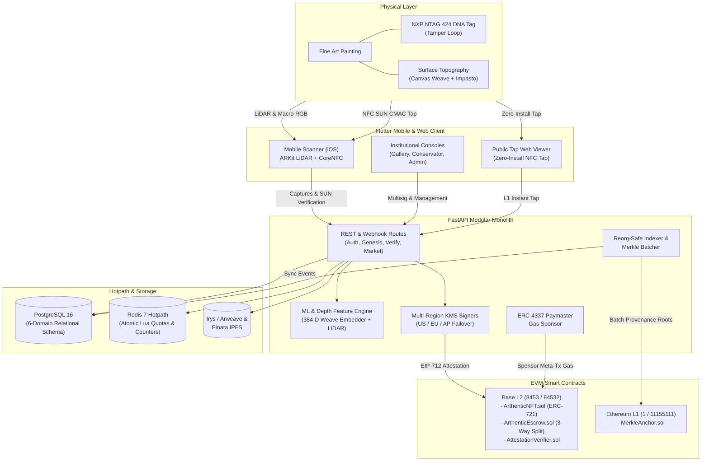
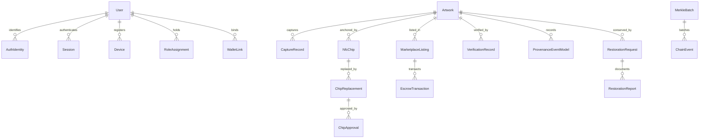
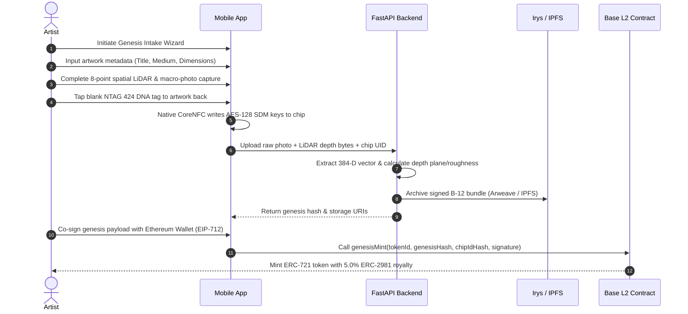
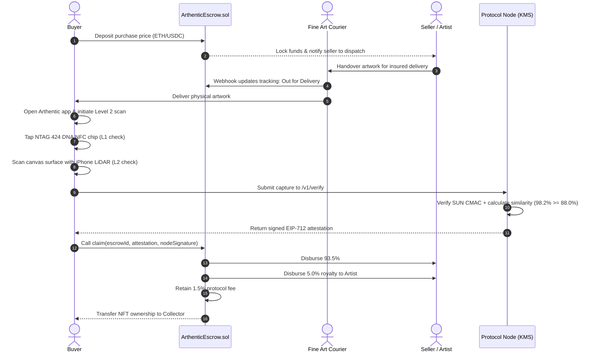
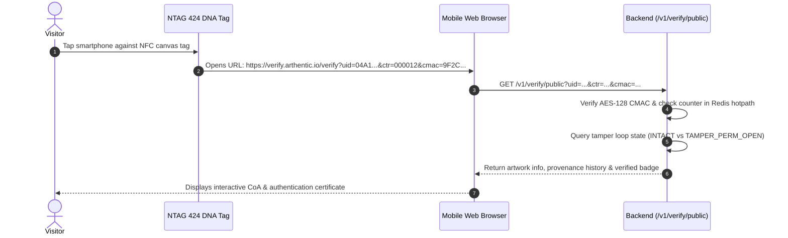

# Arthentic: Physical Artwork Authentication & Decentralized Art Protocol

[](https://github.com/arthentic/arthentic-mobile/actions)
[](https://soliditylang.org/)
[](https://fastapi.tiangolo.com/)
[](https://flutter.dev/)
[](https://getfoundry.sh/)
[](#testing-benchmarks--verification)

**Arthentic** is an end-to-end physical-to-digital artwork authentication, provenance, and decentralized escrow platform. It cryptographically binds physical canvas paintings and sculptures to verifiable on-chain digital identities on Ethereum and Base L2.

Arthentic solves the trillion-dollar art world problem of counterfeits, provenance forgery, and risky remote transactions by pairing **iPhone 12+ Pro LiDAR spatial depth scanning + macro-optical canvas weave analysis ("physical fingerprint")** with **tamper-evident NXP NTAG 424 DNA SUN NFC hardware tags** and **EIP-712 attestation-gated smart contracts**.

---

## Table of Contents

1. [What is Arthentic?](#what-is-arthentic)
2. [Key Capabilities & Features](#key-capabilities--features)
3. [System Architecture](#system-architecture)
4. [Data Structures & Schemas](#data-structures--schemas)
5. [Usage Flow & User Journeys](#usage-flow--user-journeys)
6. [Step-by-Step Installation & Setup](#step-by-step-installation--setup)
7. [Running the Application](#running-the-application)
8. [Testing, Benchmarks & Verification](#testing-benchmarks--verification)
9. [Pre-Seeded Demo Accounts](#pre-seeded-demo-accounts)
10. [Network Configuration & Smart Contracts](#network-configuration--smart-contracts)
11. [Architecture Decision Records (ADRs)](#architecture-decision-records-adrs)

---

## What is Arthentic?

Traditional fine art provenance relies on fragile paper Certificates of Authenticity (CoAs), auction house paperwork, and subjective expert appraisal—vulnerable to theft, duplication, and substitution attacks.

Arthentic introduces a **two-factor physical authentication system** for physical fine art:

1. **Something the artwork HAS (Hardware Token):** An embedded NXP NTAG 424 DNA NFC chip equipped with Secure Unique NFC (SUN) dynamic AES-128 CMAC cryptography and a physical conductive tamper loop (`TAMPER_PERM_OPEN`).
2. **Something the artwork IS (Intrinsic Biometric):** The micro-topological surface topology of the canvas substrate, paint impasto relief, and optical weave structure, captured via iPhone LiDAR `sceneDepth` point clouds and high-resolution macro photography.

Together, these factors are signed by decentralized **Protocol Node HSM/KMS Signers** using EIP-712 structured data and settled on **EVM Smart Contracts (Base L2 & Ethereum L1)**.

---

## Key Capabilities & Features

### 1. Dual-Layer Verification Engine

| Level | Name | Verification Method | Target User | Security Guarantee |
|---|---|---|---|---|
| **Level 1 (L1)** | **Instant Public Tap** | NXP NTAG 424 DNA SUN dynamic AES-128 CMAC + anti-replay counter tracking + physical tamper-loop check. | Museum visitors, gallery guests, retail buyers. | Prevents chip cloning and replay attacks. Works zero-install in web browsers (`/verify?uid=...&ctr=...&cmac=...`). |
| **Level 2 (L2)** | **Deep Physical Fingerprint Scan** | 8-point spatial guided LiDAR 3D mesh (`256x192` float32 depth) + 384-dimensional Siamese CNN/ViT optical weave embedding. | Curators, registrars, art conservators, escrow buyers. | Detects 2D photographic prints, synthetic canvases, and swapped physical artworks. Requires similarity score $\ge 88.0\%$ (`8800 bps`). |

- **Flatness Gate & Impostor Defense:** Rejects flat paper and canvas prints by evaluating surface variance ($\sigma^2$), spatial plane deviation, and signal-to-noise ratio (SNR).
- **Substrate Calibration:** Normalizes capture parameters across Linen Canvas, Wood Panel, Impasto Oil, and Watercolor paper.

### 2. Genesis Artwork Intake & CoA

- **3-Stage Guided Intake Wizard:** Metadata registration $\to$ 8-point LiDAR surface baseline capture $\to$ CoreNFC NTAG 424 DNA SDM tag provisioning.
- **EIP-712 Artist Co-Signing:** Immutable cryptographic binding between the artist's Ethereum address, the chip ID hash, and the surface genesis hash (`SC-GEN-01`, `SC-CHIP-01`).
- **Dual Decentralized Storage:** Raw capture bundles and high-resolution imaging permanently archived to **Irys / Arweave** with secondary pinning on **Pinata IPFS**.
- **Interactive Certificate of Authenticity (CoA):** On-chain verified digital certificate (`/coa/{tokenId}`) with interactive 3D surface depth relief visualization.

### 3. Physical-Confirmation Marketplace & Escrow

- **3-Way Payment Conservation:** Escrow balances split deterministically upon settlement:
  - **Seller Payout** ($93.5\%$)
  - **Artist Resale Royalty** ($5.0\%$, adhering to ERC-2981)
  - **Protocol Fee** ($1.5\%$)
- **Physical Verification Release Gate:** Escrow funds cannot be released by a button click. The buyer must physically scan and verify the artwork upon delivery using Level 2 verification. A protocol node signs an EIP-712 attestation to release the smart contract escrow.
- **Dispute & Refund Protection:** Automated timeout sweeps and integrated carrier tracking webhooks (e.g. DHL Fine Art shipping updates).

### 4. Identity & Institutional Role Governance

- **Tri-Factor Authentication:**
  - Sign-In with Ethereum (SIWE / EIP-191) with nonce invalidation.
  - Social OAuth 2.0 (Google & Apple) with cryptographic RS256 JWKS validation.
  - Email & Password with Argon2id hashing and dual-key JWT rotation (`kid`).
- **Institutional Roles:** `Artist`, `Collector`, `Gallery` (`VERIFIER_ROLE`), `Conservator` (`CONSERVATOR_ROLE`), and `Admin` (`DEFAULT_ADMIN_ROLE`).
- **Biometric App Lock:** Face ID / Touch ID `AppLockGate` with local session encryption and automatic background timeout.

### 5. Conservation Studio & 3-of-3 Chip Replacement

- **Restoration Dossiers:** Track structural damage, paint losses, cleaning procedures, and climate readings over decades.
- **3-of-3 Multisig Chip Recovery:** If an NFC chip is physically damaged or its tamper loop is severed (`TAMPER_PERM_OPEN`), the chip can be replaced on-chain only when 3 authorized parties co-sign: **Artist + Gallery/Owner + Protocol Admin**.

### 6. Protocol Node, HSM/KMS & Blockchain Infrastructure

- **Multi-Region KMS Cluster:** Secp256k1 protocol signing cluster spanning `us-east-1` (Primary), `eu-west-1` (Secondary), and `ap-southeast-1` (Tertiary) with automated failover and low-$s$ EIP-2 signature normalization.
- **FIPS 140-3 Ceremony Engine:** 3-of-5 custodian quorum key generation ceremony for mainnet deployments.
- **L1 Merkle Batch Anchoring:** High-frequency L2 provenance events periodically batched into cryptographic Merkle roots and committed to Ethereum L1 via `MerkleAnchor.sol`.
- **ERC-4337 Account Abstraction:** Gas sponsorship paymaster policy engine with balance threshold monitoring.
- **Production SLA Governor:** 5-KPI runtime monitor tracking verification latency, failure rates, and node drift, with automated circuit breaking on P0 anomalies.

### 7. Adaptive Multi-Platform Client

- **Native iOS Module:** ARKit `sceneDepth` LiDAR capture and CoreNFC NTAG 424 DNA provisioning.
- **Responsive Institutional Consoles:** Automatically renders a compact mobile UI (< 900px) or a comprehensive desktop workspace ($\ge$ 900px) with dedicated consoles:
  - **Gallery Safe Console:** Gnosis Safe multisig treasury and inventory management.
  - **Conservator Studio Console:** Condition reports, restoration approvals, and microscopic scan diffs.
  - **Protocol Admin Console:** Signer node health, gas tank monitoring, and security incident response.

---

## System Architecture

Arthentic is engineered as a unified **3-pillar monorepo**:

```
                       ┌────────────────────────────────────────────────────────┐
                       │               Arthentic Monorepo                       │
                       └─────────────────────────┬──────────────────────────────┘
                                                 │
          ┌──────────────────────────────────────┼──────────────────────────────────────┐
          ▼                                      ▼                                      ▼
┌───────────────────┐                  ┌───────────────────┐                  ┌───────────────────┐
│     contracts/    │                  │      server/      │                  │        app/       │
│  Solidity 0.8.24  │                  │  FastAPI Monolith │                  │  Flutter iOS/Web  │
│  Foundry Fuzzing  │                  │  Python 3.9+ / ML │                  │  Swift Native / JS│
└───────────────────┘                  └───────────────────┘                  └───────────────────┘
```

### High-Level System Flow



### Six Infrastructure Layers

1. **Layer 1: Smart Contracts (`contracts/`):** Core on-chain logic written in Solidity 0.8.24. Handles NFT minting with immutable genesis hashes, ERC-2981 royalties, multi-signature chip replacement, and attestation-gated escrow settlement.
2. **Layer 2: Production Persistence & Hotpath (`server/db/`):** PostgreSQL 16 schema managed with Alembic migrations + Redis 7 caching hotpath executing atomic Lua scripts for counter protection and quota management.
3. **Layer 3: Protocol Node & Cryptography (`server/node/`, `server/crypto/`):** AWS KMS / HashiCorp Vault secp256k1 signers producing EIP-712 attestations with low-$s$ clamping, paired with NTAG 424 DNA SUN AES-128 CMAC decryption.
4. **Layer 4: Reorg-Safe Chain Indexer (`server/indexer/`):** Web3 event listener monitoring on-chain transfers, listings, and chip changes, supporting chain reorganization rollbacks and periodic L1 Merkle anchoring.
5. **Layer 5: ERC-4337 Paymaster (`server/paymaster/`):** Policy engine validating user operations, tracking sponsor quota allocations, and monitoring paymaster contract deposits.
6. **Layer 6: Client Applications (`app/`):** Multi-platform Flutter app offering native iOS ARKit and CoreNFC integrations, Web EIP-1193 browser injection (`window.ethereum`), Gnosis Safe Apps SDK compatibility, and deep-link routing.

---

## Data Structures & Schemas

### Relational Schema (SQLAlchemy 2.0 Models)

The backend database (`server/db/models.py`) is organized into 6 domains:



#### Key Tables & Fields:

- **`users`:** `id`, `email`, `display_name`, `password_hash`, `status`, `created_at`, `email_verified_at`.
- **`auth_identities`:** `user_id`, `provider` (`google`, `apple`, `metamask`), `provider_subject`.
- **`artworks`:**
  - `id`, `token_id`, `title`, `artist_name`, `artist_address`, `medium`, `year_created`, `dimensions`.
  - `genesis_hash`: SHA-256 hash of baseline optical + LiDAR features (immutable).
  - `genesis_vector`: 384-dimensional JSON vector of optical weave features.
  - `genesis_depth`: JSON statistical surface features (mean, variance, planar slope, SNR).
  - `arweave_bundle_id`, `ipfs_cid`: Decentralized storage receipts.
  - `status`: `draft`, `registered`, `minted`, `in_escrow`, `archived`.
- **`capture_records`:** `id`, `artwork_id`, `vector` (384-D JSON), `depth_stats` (JSON), `intrinsics` (JSON), `operator_id`, `capture_type` (`genesis` vs `verify`).
- **`nfc_chips`:** `id`, `artwork_id`, `uid_hash`, `key_version`, `last_counter`, `tamper_state` (`INTACT`, `TAMPER_PERM_OPEN`).
- **`marketplace_listings`:** `id`, `artwork_id`, `seller_address`, `price_wei`, `status` (`active`, `escrowed`, `sold`, `cancelled`).
- **`escrow_transactions`:** `id`, `listing_id`, `buyer_wallet`, `amount_wei`, `carrier_tracking_code`, `status` (`funded`, `in_transit`, `delivered_pending_scan`, `completed`, `refunded`).
- **`verification_records`:** `id`, `artwork_id`, `verifier_id`, `level` (`L1_TAP` or `L2_OPTICAL_LIDAR`), `similarity_bps`, `result` (`GENUINE`, `IMPOSTOR_SUSPECT`, `FLAT_PRINT_REJECTED`).
- **`restoration_requests`:** `id`, `artwork_id`, `conservator_id`, `condition_grade`, `status`.

### Redis 7 Hotpath Cache Keys

| Key Pattern | Data Structure | Purpose |
|---|---|---|
| `sun:ctr:{uid}` | `Integer` | Last validated NTAG 424 DNA SUN counter (anti-replay check). |
| `rate:verify:{ip}` | `Integer` + Expiry | Leaky-bucket rate limiter for verification queries. |
| `cache:artwork:{id}` | `JSON String` | High-frequency read cache for public CoA viewer. |
| `paymaster:quota:{wallet}` | `Integer` | Sponsored transaction daily allowance (ERC-4337). |
| `indexer:last_block` | `Integer` | Last processed block height for reorg recovery. |
| `sla:kpi:rolling` | `Hash` | Real-time moving average of verification latency and failure rates. |

---

## Usage Flow & User Journeys

### 1. Artist Genesis Intake & On-Chain Minting



### 2. Collector Purchase & Physical Escrow Release



### 3. Zero-Install Public NFC Tap (Museum / Gallery Visitor)



---

## Step-by-Step Installation & Setup

### System Prerequisites

Ensure you have the following installed on your host machine:

- **Git** (`git --version` $\ge 2.30$)
- **Python 3.9+** (`python3 --version`, recommended: 3.11 or 3.12)
- **Node.js & npm** (`node --version` $\ge 18$)
- **Docker & Docker Compose** (Docker Desktop on macOS/Windows, docker-ce on Linux)
- **Foundry** (`forge`, `cast`, `anvil`) $\to$ Install via:
  ```bash
  curl -L https://foundry.paradigm.xyz | bash && foundryup
  ```
- **Flutter SDK** (`flutter --version` $\ge 3.24$)
- **Xcode** (for macOS / iOS Simulator and device deployment)

---

### Option A: 1-Command Spinup via Docker Compose (Recommended)

The repository provides a complete containerized stack featuring PostgreSQL 16, Redis 7, an Anvil local EVM blockchain pre-deployed with the smart contracts, and the FastAPI backend service:

```bash
# 1. Clone the repository
git clone https://github.com/arthentic/arthentic-mobile.git
cd arthentic-mobile

# 2. Launch the full-stack orchestration
docker compose up --build
```

**Running Services:**
- **FastAPI Modular Monolith:** `http://localhost:8000` (Swagger docs: `http://localhost:8000/docs`)
- **Readiness Healthcheck:** `http://localhost:8000/health`
- **PostgreSQL 16 Database:** `localhost:5432` (`arthentic_db`)
- **Redis 7 Hotpath:** `localhost:6379`
- **Anvil Local EVM Node:** `http://localhost:8545` (Base Sepolia fork: `84532`)

---

### Option B: Manual Local Development Setup

#### Step 1: Environment Configuration

Create an environment file `.env` in the project root:

```bash
cat << 'EOF' > .env
DATABASE_URL=sqlite:///./arthentic.db
REDIS_URL=redis://localhost:6379/0
JWT_SECRET_KEY=arthentic-super-secure-local-dev-secret-key-32-chars!
JWT_ACTIVE_KID=v1
KMS_PROVIDER=local_enclave
BASE_RPC_URL=https://sepolia.base.org
BASE_CHAIN_ID=84532
ETH_L1_RPC_URL=https://rpc.sepolia.org
ETH_L1_CHAIN_ID=11155111
EOF
```

#### Step 2: Build & Test Smart Contracts

```bash
cd contracts

# Install dependencies and compile contracts
forge install
forge build

# Run invariant fuzz tests
forge test

# Return to root directory
cd ..

# Synchronize generated ABIs to server and app
python3 scripts/sync_abis.py
```

#### Step 3: Set Up Python Backend Environment

```bash
# Create and activate Python virtual environment
python3 -m venv server/venv
source server/venv/bin/activate

# Upgrade packaging tools and install dependencies
pip install --upgrade pip
pip install -r server/requirements.txt

# Run database migrations
alembic upgrade head

# Seed initial roles and demo users
python3 -c "from server.db.seed import seed_dev_users; seed_dev_users()"
```

#### Step 4: Set Up Flutter Mobile & Web Client

```bash
cd app

# Fetch Flutter dependencies
flutter pub get

# Verify tooling setup
flutter doctor
```

---

## Running the Application

### 1. Start the Backend API Server

```bash
# In the repository root:
source server/venv/bin/activate
uvicorn server.main:app --host 0.0.0.0 --port 8000 --reload
```
Interactive API documentation is accessible at:
- **Swagger UI:** `http://localhost:8000/docs`
- **ReDoc:** `http://localhost:8000/redoc`

### 2. Run the Flutter Mobile App (iOS / Simulator)

To run the mobile app on an iPhone with LiDAR (e.g., iPhone 12 Pro or newer) or the iOS Simulator:

```bash
cd app

# List connected devices and simulators
flutter devices

# Run on iOS Simulator
flutter run -d iPhone

# Or run directly in Chrome (Web Console Mode)
flutter run -d chrome --web-port 3000
```

> **Note on Physical LiDAR & NFC:** On simulators or non-LiDAR devices, the app automatically switches to **mock fallback mode**, generating synthetic depth meshes and simulated SUN CMAC tags so you can test all workflows end-to-end without physical hardware.

### 3. Open Institutional Web Consoles

Run the Flutter client in a desktop browser to access the institutional portals:

| Portal | URL Route | Description | Target Role |
|---|---|---|---|
| **Gallery Safe Console** | `http://localhost:3000/#/console/gallery` | Gnosis Safe multisig treasury, minting, and sales management. | `Gallery` (`VERIFIER_ROLE`) |
| **Conservator Studio** | `http://localhost:3000/#/console/conservator` | Condition reports, restoration dossiers, and 3-of-3 chip replacement. | `Conservator` |
| **Governance & Incidents** | `http://localhost:3000/#/console/admin` | Multi-region KMS health, gas tank monitoring, and circuit breakers. | `Admin` |
| **Public Tap Web Viewer** | `http://localhost:3000/#/verify?uid=04A1B2C3D4E580&ctr=1&cmac=A9E38F107B5C2D44` | Zero-install visitor verification. | Public |
| **Certificate of Authenticity** | `http://localhost:3000/#/coa/101` | Public on-chain CoA with interactive 3D canvas relief visualizer. | Public |

---

## Testing, Benchmarks & Verification

The repository contains an automated test matrix with **327 automated tests** spanning all 3 monorepo pillars.

### 1. Run the Backend Test Suite (Pytest)

Executes 230 unit, integration, and security tests covering auth, encryption, Redis quotas, and routing:

```bash
PYTHONPATH=. server/venv/bin/pytest server/tests -v
```

### 2. Run Smart Contract Tests (Foundry)

Executes unit and invariant fuzz tests verifying genesis hash immutability, royalty math, and escrow solvency:

```bash
cd contracts
forge test -vvv
cd ..
```

### 3. Run Flutter Client Tests

Executes 84 widget, navigation, and mock hardware bridge tests:

```bash
cd app
flutter test
cd ..
```

### 4. Run the Full-Stack Smoke Runner

Validates all 6 architecture layers programmatically in 1 command:

```bash
python3 scripts/verify_full_stack.py
```

### 5. Run the Surface Calibration Benchmark

Evaluates optical and LiDAR matching against genuine samples, impostor canvases, and presentation paper-print attacks:

```bash
PYTHONPATH=. server/venv/bin/python3 fixtures/calibrate.py
```

**Benchmark Results:**
- **Same Surface (Genuine Canvas):** $\sim 98.2\%$ cosine similarity $\to$ **PASS**
- **Different Surface (Impostor Canvas):** $\sim 73.1\%$ similarity $\to$ **REJECTED** ($< 88.0\%$ threshold)
- **Flat Paper Print Attack (Counterfeit):** $\sim 36.7\%$ similarity $\to$ **REJECTED** (failed flatness gate)

---

## Pre-Seeded Demo Accounts

When seeded via `seed_dev_users()`, the following accounts are available for local evaluation:

| Email | Password | Assigned Role | Primary Workspace |
|---|---|---|---|
| `collector@arthentic.io` | `Collector123!` | *Standard User* | Mobile App / Marketplace & Collection |
| `artist@arthentic.io` | `Artist123!` | `Artist` | Genesis Intake Wizard & Artist Dashboard |
| `gallery@arthentic.io` | `Gallery123!` | `Gallery` | Gallery Safe Institutional Console |
| `conservator@arthentic.io` | `Conservator123!` | `Conservator` | Conservator Studio Console & 3-of-3 Replacement |
| `admin@arthentic.io` | `Admin123!` | `Admin` | Governance, Multi-Region KMS & Incident Console |
| `multirole@arthentic.io` | `MultiRole123!` | `Artist`, `Conservator`, `Gallery` | Unified Multi-Role Testing |

---

## Network Configuration & Smart Contracts

### Supported Networks

| Parameter | Base Sepolia (Testnet) | Base Mainnet (Production) | Ethereum Sepolia (L1 Anchor) | Ethereum Mainnet (L1 Anchor) |
|---|---|---|---|---|
| **Chain ID** | `84532` | `8453` | `11155111` | `1` |
| **ArthenticNFT** | `0x1111...0001` | Multi-sig Timelock | — | — |
| **ArthenticEscrow** | `0x1111...0002` | Multi-sig Timelock | — | — |
| **MerkleAnchor** | — | — | `0x1111...0003` | Multi-sig Timelock |
| **Governance** | Deployer EOA | 3-of-5 Gnosis Safe (48h Timelock) | Deployer EOA | 3-of-5 Gnosis Safe (48h Timelock) |

### Invariants & Security Guarantees

- **`SC-GEN-01` (Genesis Hash Immutability):** Once an artwork's optical and LiDAR fingerprint is committed via `genesisMint()`, it can never be altered on-chain or in the database (`forbid_genesis_change()` PostgreSQL trigger).
- **`SC-CHIP-01` (Chip Collision Rejection):** An NFC chip UID hash can only be bound to exactly one token ID in history.
- **`ADR-04` / `ADR-05` (Escrow Solvency & Conservation):** Total escrow liabilities equal exact ETH/ERC-20 deposits. Withdrawals are strictly limited to the buyer-verified 3-way split.
- **`EIP-2` (Low-$s$ Signature Enforcement):** All ECDSA secp256k1 signatures are clamped to $s \le N/2$ to prevent transaction malleability.

---

## Architecture Decision Records (ADRs)

This section documents the **why** behind major technical and product decisions in Arthentic. These are not obvious choices — each was made after evaluating alternatives against the requirements of a tamper-proof, high-stakes art authentication protocol.

---

### ADR-01 · Two-Factor Physical Authentication (Hardware + Biometric)

**Decision:** Require both an NXP NTAG 424 DNA NFC chip *and* an iPhone LiDAR/optical surface scan to authenticate any artwork.

**Why:**
- NFC chips alone can be cloned and transplanted into a forgery. An embedded tamper loop (`TAMPER_PERM_OPEN`) deters removal, but a motivated attacker could still attempt it.
- Optical/LiDAR surface fingerprints alone cannot be revoked or replaced if a chip is lost or damaged.
- **Two independent factors create an insurmountable attack surface:** cloning the chip is futile if the canvas weave does not match, and replicating a micro-topology surface scan is futile without the embedded chip producing a valid CMAC counter.
- This directly mirrors the physical-world "two-factor" standard — something you *have* (chip) + something you *are* (intrinsic surface).

---

### ADR-02 · NXP NTAG 424 DNA with SUN (Secure Unique NFC) — Not a Static QR Code or Plain NFC

**Decision:** Use NXP NTAG 424 DNA chips with AES-128 CMAC Secure Dynamic Messaging (SDM/SUN), not static QR codes, plain NDEF NFC tags, or EPC RFID.

**Why:**
- **Static QR codes and plain NFC tags can be trivially photocopied.** Any printer or NFC writer can clone them.
- **NTAG 424 DNA SDM dynamically re-signs every tap** with an AES-128 CMAC keyed MAC that includes the chip's UID and a monotonically increasing read counter. Each tap produces a cryptographically unique URL (`?uid=...&ctr=...&cmac=...`).
- The anti-replay counter (`sun:ctr:{uid}` in Redis) rejects any tap that presents a counter equal to or lower than a previously validated tap, defeating recording and replay attacks.
- The physical tamper loop (`TAMPER_PERM_OPEN`) provides a permanent, one-way signal if the chip is surgically extracted from the canvas.

---

### ADR-03 · iPhone LiDAR (`sceneDepth`) + 384-D Siamese CNN Weave Embedding — Not Just Image Hashing

**Decision:** Combine iPhone 12 Pro+ ARKit `sceneDepth` point-cloud capture (`256×192` float32) with a 384-dimensional Siamese CNN/ViT optical embedding of canvas texture. Require ≥ 8800 bps (88.0%) cosine similarity to pass Level 2.

**Why:**
- **Perceptual hashing (pHash, dHash) is defeated by photo-quality printing.** A high-DPI inkjet print of a painting photograph scores near 100% on perceptual hashes.
- **LiDAR alone is fragile** if the painting is photographed in 3D (e.g., with a structured-light scanner). A painting print on a textured substrate could fool a coarse depth map.
- **Combining micro-topology (LiDAR) + weave texture (optical embedding)** creates a dual-channel fingerprint: the LiDAR flatness gate (surface variance σ², plane deviation, SNR) immediately rejects flat paper prints (~36.7% similarity), while the optical embedding distinguishes genuine canvas weave from synthetic materials.
- The 88.0% threshold is calibrated empirically: genuine same-canvas re-scans average ~98.2%, impostor canvases average ~73.1%, and flat paper prints are gated out at the flatness check before reaching cosine comparison.

---

### ADR-04 · EIP-712 Typed Structured Data for All On-Chain Attestations — Not Raw `eth_sign`

**Decision:** All protocol node signatures (genesis co-sign, verification attestations, escrow release, conservation consent, chip replacement) use EIP-712 typed structured data signed with the protocol's KMS key.

**Why:**
- **`eth_sign` and `personal_sign` are opaque.** Users (and auditors) cannot read what they are signing; only a hex blob is presented.
- **EIP-712 renders the full domain separator, field names, and values** in MetaMask and hardware wallet UIs before the user approves. An artist co-signing a genesis payload sees `{ title, genesisVectorHash, chipIdHash, royaltyBps: 500 }` in plain text.
- **Replay protection is built-in:** Each attestation includes `nonce`, `deadline`, and `chainId`. The `AttestationVerifier.sol` contract enforces deadline expiry, one-time nonce consumption, and chain-ID matching, making cross-chain or delayed replays impossible.
- `ADR-04` is directly tested in `ArthenticProtocol.t.sol` as a Foundry invariant fuzz test.

---

### ADR-05 · Base L2 (EVM) for NFT + Escrow, Ethereum L1 for Merkle Anchoring — Not a Single Chain

**Decision:** Deploy `ArthenticNFT` and `ArthenticEscrow` on Base L2 (chain IDs `84532`/`8453`), and batch-anchor provenance Merkle roots to Ethereum L1 (`MerkleAnchor.sol`) via a periodic batcher.

**Why:**
- **Ethereum L1 gas costs make sub-$1 art transactions uneconomical.** A single L1 ERC-721 mint during congestion can cost \$20–\$200 in gas. Base L2 brings this to fractions of a cent.
- **Security still anchors to Ethereum L1:** Every 1,000 provenance events (or 24 hours), the indexer batches them into a Merkle root and calls `MerkleAnchor.anchorRoot()` on Ethereum Mainnet. This means the full provenance history has Ethereum-grade finality without paying per-event L1 gas.
- **ERC-4337 Account Abstraction (Paymaster)** on Base L2 allows the protocol to sponsor gas for artists and collectors for their first few transactions, dramatically lowering onboarding friction without sacrificing security.

---

### ADR-06 · 3-Way Escrow Split (93.5% / 5.0% / 1.5%) Released Only on Physical Verification — Not on Delivery Confirmation

**Decision:** Escrow funds can only be released by the buyer submitting a valid EIP-712 attestation produced by the protocol node after a successful Level 2 NFC + LiDAR scan. Carrier delivery confirmation alone is insufficient.

**Why:**
- **Delivery ≠ Authenticity.** A buyer could receive a substitute artwork (a forgery, a different painting, or a damaged piece) and a standard delivery-based escrow would auto-release to the seller. The physical verification requirement proves the *correct, undamaged* artwork arrived.
- **The 5.0% artist resale royalty (ERC-2981 compliant)** is enforced on-chain at the smart-contract level, not via a voluntary UI toggle. This protects artists in secondary markets even when Arthentic's backend is bypassed by direct contract interaction.
- The 1.5% protocol fee sustains KMS infrastructure, node operations, and insurance reserves.
- **`ADR-05` (Escrow Solvency Invariant):** The Foundry invariant fuzz test `ArthenticInvariant.t.sol` verifies that total ETH liabilities always equal exact deposits — no scenario (including concurrent claims, edge-case royalty rounding, or expired refunds) can cause the contract to owe more ETH than it holds.

---

### ADR-07 · Argon2id for Passwords, Dual-Key JWT Rotation (`kid`), and Strict Refresh Token Family Revocation

**Decision:** Use Argon2id (`time_cost=3`, `memory_cost=65536`, `parallelism=4`) for password hashing. Rotate access JWTs every 15 minutes. Rotate refresh tokens on every use and revoke the entire token *family* on reuse detection.

**Why:**
- **Argon2id is the 2015 Password Hashing Competition winner** and is memory-hard (defeats GPU/ASIC attacks) and side-channel resistant. The parameters are tuned to ~120ms on server hardware — enough to resist brute force while keeping login latency acceptable on mobile.
- **15-minute access JWT lifetime:** Role changes (e.g., admin revoking a compromised gallery account) take effect within one token lifetime without requiring a live token revocation list. Sensitive endpoints additionally call `check_db=True` to verify role status in real-time.
- **Refresh token family revocation:** If a stolen refresh token is used, the server detects token reuse (the original user's next request presents an already-consumed token), immediately revokes every token in that session family, and forces re-login. This is the mitigation for `TM-AUTH-1`.
- **Dual-key rotation (`kid`):** JWTs include a key ID header, allowing the server to rotate signing secrets gracefully without instantly invalidating all active sessions.

---

### ADR-08 · iOS Keychain with `kSecAttrAccessibleWhenPasscodeSetThisDeviceOnly` — Not `UserDefaults` or App Sandbox Files

**Decision:** Refresh tokens are stored exclusively in the iOS Keychain using the `kSecAttrAccessibleWhenPasscodeSetThisDeviceOnly` access class. Access tokens are held in transient runtime memory only.

**Why:**
- **`UserDefaults` and app sandbox files are included in iCloud backups and iTunes backups.** A stolen backup (even an encrypted one, under some forensic scenarios) could expose tokens.
- **`kSecAttrAccessibleWhenPasscodeSetThisDeviceOnly` is automatically wiped if the device passcode is removed** and is never synced to iCloud Keychain or transferred to another device during a restore. This closes `TM-AUTH-5` and `TM-AUTH-6`.
- Storing access tokens only in memory means they are never written to disk and are destroyed on app termination. A cold-boot or crash recovery requires a refresh token exchange, not a file system read.

---

### ADR-09 · 3-of-3 Multisig Chip Replacement — Not Unilateral Admin Override

**Decision:** Replacing a damaged or tampered NFC chip on a registered artwork requires co-signatures from all three parties: **Collector (artwork owner) + Artist + Protocol Verifier (Gallery)**. Any single party can block a replacement.

**Why:**
- **Unilateral chip replacement is the highest-risk attack vector** for the entire system. If an admin or gallery could replace a chip alone, they could rebind a stolen painting's chip to a legitimate chain record — effectively laundering a theft on-chain.
- Requiring the **artist** guarantees that the original creator authorizes the physical alteration.
- Requiring the **collector (owner)** prevents a gallery or conservator from swapping a chip without the owner's knowledge.
- Requiring the **protocol verifier** adds an institutional check that a fresh optical L2 scan (≥ 8800 bps) confirms the correct artwork before the new chip is bound.
- This design is inspired by the 3-of-5 Gnosis Safe governance model used for protocol upgrades, applied to physical hardware management.

---

### ADR-10 · FastAPI Modular Monolith — Not Microservices

**Decision:** The backend is a single deployable FastAPI application with internal module boundaries (`server/auth/`, `server/node/`, `server/indexer/`, `server/paymaster/`, `server/routes/`), not separate microservices.

**Why:**
- **Distributed transactions across microservices are complex** when atomicity matters. For example, a genesis mint must atomically write to PostgreSQL, pin to Arweave/IPFS, and broadcast to the blockchain. Coordinating this across three separate services requires distributed sagas or outbox patterns — significant added complexity for a v1 system.
- **A modular monolith allows surgical extraction** of individual modules (e.g., the Protocol Node or Paymaster) into independent services later, without rewriting internal interfaces. Module boundaries are enforced as Python package imports, not network calls.
- **Operational simplicity:** A single Docker container is deployed, monitored, and rolled back. The CI/CD pipeline runs in one `pytest` invocation across all 100 backend tests with shared fixtures and an in-memory SQLite database.

---

### ADR-11 · PostgreSQL 16 (Production) + SQLite (Development/Test) via SQLAlchemy — Not a NoSQL Store

**Decision:** All structured data (users, artworks, captures, escrows, provenance events) is stored in a relational database with a strict schema enforced by SQLAlchemy 2.0 ORM and Alembic migrations. PostgreSQL is used in production; SQLite is used in local development and CI tests.

**Why:**
- **Art provenance is inherently relational.** An artwork has many captures; a capture belongs to one artwork; a chip replacement has multiple approvals; an escrow transaction links a listing to a buyer, seller, carrier, and on-chain transaction hash. ACID transactions and foreign key constraints prevent orphaned records and data corruption at the database level.
- **`SC-GEN-01` (Genesis Hash Immutability)** is enforced by a PostgreSQL trigger (`forbid_genesis_change()`), not just application-layer checks. This means even a direct database connection cannot overwrite a committed `genesis_hash` — the trigger raises an exception.
- **Redis 7** handles the *hotpath* (SUN anti-replay counters, rate limiters, paymaster quotas) where atomic Lua scripts provide compare-and-set semantics without full ACID overhead. This offloads the high-frequency per-tap counter increment from PostgreSQL.

---

### ADR-12 · Multi-Region KMS Cluster (US / EU / AP) with Low-s EIP-2 Signature Clamping

**Decision:** Protocol signing keys live exclusively in cloud KMS (AWS KMS or HashiCorp Vault Transit), never in application memory or environment variables. Signatures are clamped to low-s form per EIP-2.

**Why:**
- **Private keys in environment variables or config files** are routinely leaked through misconfigured CI/CD pipelines, Docker image layers, and log aggregation. KMS ensures keys are never extractable — even operators cannot export the raw private key material.
- **Multi-region failover (US-East-1 primary → EU-West-1 secondary → AP-Southeast-1 tertiary)** ensures the protocol can continue signing attestations and releasing escrow even during a regional AWS outage. The cluster uses automated health probes and switches signing regions within seconds.
- **Low-s EIP-2 clamping:** Ethereum signatures have two valid `(r, s)` values for any message (`s` and `N - s`). Without clamping, an adversary can produce a second valid signature for the same payload without knowing the private key, enabling transaction malleability attacks. All signatures are normalized to `s ≤ N/2` before broadcasting.

---

### ADR-13 · Flutter for Cross-Platform UI + Native Swift Bridges for Hardware — Not React Native or Pure Web

**Decision:** The client app is built in Flutter (Dart), with native Swift modules (`AppDelegate.swift`) handling CoreNFC NTAG 424 DNA SDM provisioning and ARKit `sceneDepth` LiDAR capture via Flutter platform channels.

**Why:**
- **LiDAR (`ARKit sceneDepth`) and CoreNFC NTAG 424 DNA** are exclusive to the Apple ecosystem and have no cross-platform wrapper in React Native or Capacitor that exposes the low-level APIs needed (raw float32 depth buffers, SUN CMAC NDEF parsing). Native Swift bridges via Flutter platform channels are the only viable path.
- **Flutter renders a single Dart codebase** to iOS native, Web (institutional consoles), and potentially Android — reducing duplication of the UI and business logic for auth, marketplace, and provenance screens.
- The responsive shell (< 900px → mobile `BottomNavigationBar`; ≥ 900px → desktop `NavigationRail`) means Gallery, Conservator, and Admin institutional web consoles share the same codebase as the mobile scanner app.

---

## License

This project is licensed under the MIT License — see the [LICENSE](LICENSE) file for details.
