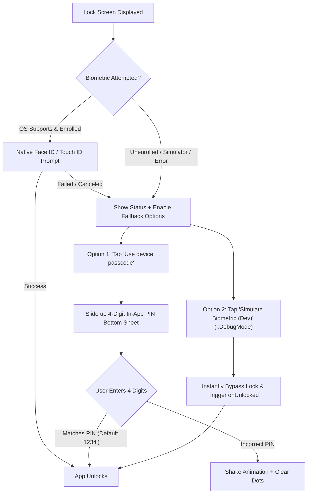

# App Lock: Biometric Unlock, Simulator Dev Bypass & In-App PIN Fallback Plan

## 1. Executive Summary & Root Cause Analysis

### The Root Cause on iOS Simulator
When running on the iOS Simulator:
1. **Unenrolled Hardware**: iOS Simulator does not have Face ID, Touch ID, or a device passcode enrolled by default.
2. **Platform Exception**: Calling `_auth.authenticate()` raises `PlatformException(NotEnrolled, 'User has not enrolled any biometrics')` or returns `false`.
3. **Dead-End Passcode Button**: Tapping `"Use device passcode"` calls `_auth.authenticate(biometricOnly: false)`. Because the simulator does not have a system passcode set in iOS Settings, this also fails immediately, leaving the user permanently locked out on the Lock Screen.

### The Solution Architecture

---

## 2. Test-First Specification (`app/test/app_lock_test.dart`)

| Test ID | Test Name | Expected Behavior |
| :--- | :--- | :--- |
| **T-PIN.1** | `Default fallback PIN is '1234'` | `appLockService.verifyFallbackPin('1234')` returns `true`. |
| **T-PIN.2** | `Invalid PIN rejected` | `appLockService.verifyFallbackPin('9999')` returns `false` and remains locked. |
| **T-PIN.3** | `Update fallback PIN persists` | `appLockService.setFallbackPin('5678')` updates secure storage; subsequent verify of `'5678'` returns `true`. |
| **T-PIN.4** | `Passcode button opens PIN sheet` | Tapping `lock_passcode_button` displays `PinPadBottomSheet` with 4 blank indicator dots and 0–9 keypad. |
| **T-PIN.5** | `PIN entry unlocks app` | Tapping digits `1`, `2`, `3`, `4` invokes `onUnlocked` and dismisses the lock overlay. |
| **T-PIN.6** | `Dev bypass button unlocks instantly` | In debug mode, finding `Key('lock_dev_simulate_button')` and tapping it unlocks the service immediately. |

---

## 3. Phase-to-Phase Implementation Plan

### Phase 1: In-App PIN Management in `AppLockService`
**Files**: `app/lib/services/app_lock_service.dart`
1. Inject secure storage for fallback PIN (`_storageKeyFallbackPin = 'arthentic_fallback_pin'`).
2. Add methods:
   - `Future<String> getFallbackPin()`: retrieves stored PIN, defaulting to `'1234'`.
   - `Future<bool> setFallbackPin(String newPin)`: validates 4 numeric digits and persists to secure storage.
   - `Future<bool> verifyFallbackPin(String enteredPin)`: compares input against stored PIN; on match calls `unlock()` and returns `true`.
   - `void devSimulateUnlock()`: convenience helper for debug mode that immediately calls `unlock()`.

---

### Phase 2: In-App PIN Pad Bottom Sheet Widget
**Files**: `app/lib/features/auth/widgets/pin_pad_sheet.dart`
1. Build a bottom sheet widget matching the Arthentic design system:
   - Header with lock icon and `"Enter Passcode"` title.
   - 4 animated dot indicators (filled when digits entered, empty when pending).
   - Numeric grid `1` through `9`, `0`, and a backspace icon button.
   - Automatic evaluation when 4 digits are entered:
     - If correct: haptic feedback, sheet closes, and `onSuccess()` callback fires.
     - If incorrect: haptic error feedback, shake animation, dots cleared, error message displayed.

---

### Phase 3: Lock Screen Dev Bypass & Passcode Wiring
**Files**: `app/lib/features/auth/lock_screen.dart`
1. Update `_promptBiometric({bool passcodeFallback = false})`:
   - If `passcodeFallback` is requested, immediately present `PinPadBottomSheet`.
   - If biometric authentication throws `NotEnrolled`, `NotAvailable`, or fails on simulator, gracefully display the status and prompt the user to use the in-app PIN.
2. In `kDebugMode`:
   - Display a stylish, unobtrusive dev badge above/below the action buttons:
     - `TextButton.icon(icon: Icons.developer_mode, label: 'Simulate Biometric Unlock (Dev)')`
     - Tapping it calls `_service.devSimulateUnlock()` and triggers `widget.onUnlocked!()`.

---

### Phase 4: Settings Integration & Fallback PIN Customization
**Files**: `app/lib/features/settings/settings_screen.dart`
1. Add a `"Security & App Lock"` section in Settings:
   - Tile: `"Change Fallback PIN"` (shows current status: `"Configured (Default 1234)"`).
   - Tapping opens a dialog/sheet to set a new 4-digit PIN.

---

### Phase 5: Verification & End-to-End Test Run
1. Run `flutter test test/app_lock_test.dart`.
2. Run full app suite `flutter test`.
3. Verify interactive flow on iOS Simulator:
   - One-tap dev bypass unlocks immediately.
   - Tapping "Use device passcode" opens PIN sheet, entering `1234` unlocks cleanly.

