# Arthentic: Master Architecture Analysis, Phase-by-Phase Implementation Plan, MetaMask Role Flows & Business Blueprint

> **Document Scope:** Comprehensive technical and business master plan synthesized from `Arthentic_UML_Diagrams_Part_1.pdf` (9 Actors, 11 Use-Case Modules, 3 Class Diagrams, 48 Activity Diagrams), `Arthentic_Sequence_and_Database_Design.pdf` (12 Sequence Diagrams `SD-01`–`SD-12`, 40 PostgreSQL 16 Tables across 6 ERDs, 6 Redis Hot-Path Keys, 9 Core Invariants), and the current `Arthenthic-Mobile` codebase (`app/` Flutter iOS + `server/` FastAPI).

---

## Table of Contents

1. [Document Analysis & Current Codebase Gap Matrix](#1-document-analysis--current-codebase-gap-matrix)
2. [Comprehensive Phase-by-Phase Implementation Plan — Mobile Side (`app/`)](#2-comprehensive-phase-by-phase-implementation-plan--mobile-side-app)
3. [Comprehensive Phase-by-Phase Implementation Plan — Other Side of the Architecture (`contracts/`, `node/`, `server/`, `indexer/`, `web/`)](#3-comprehensive-phase-by-phase-implementation-plan--other-side-of-the-architecture)
4. [Catatan Prototype #1: MetaMask Wallet Architecture & Role-by-Role Flows](#4-catatan-prototype-1-metamask-wallet-architecture--role-by-role-flows)
5. [Catatan Prototype #2: Other Auth & Account Features (Google, Apple, Biometrics & Multi-Identity Linking)](#5-catatan-prototype-2-other-auth--account-features-google-apple-biometrics--multi-identity-linking)
6. [Catatan Prototype #3: Smart Contract Architecture & Execution Flows (`Alur Smart Contract`)](#6-catatan-prototype-3-smart-contract-architecture--execution-flows-alur-smart-contract)
7. [Catatan Prototype #4: Tokenomics & Physical-to-Digital Supply Chain (`Tokenomics & Supply Chain`)](#7-catatan-prototype-4-tokenomics--physical-to-digital-supply-chain-tokenomics--supply-chain)
8. [Catatan Prototype #5: Solution Overview (Based on Project Overview)](#8-catatan-prototype-5-solution-overview-based-on-project-overview)
9. [Catatan Prototype #6: Positioning Map of Arthentic](#9-catatan-prototype-6-positioning-map-of-arthentic)
10. [Catatan Prototype #7: Benefit Plan & Business Plan Presentation](#10-catatan-prototype-7-benefit-plan--business-plan-presentation)

---

## 1. Document Analysis & Current Codebase Gap Matrix

### 1.1 Synthesis of the Two Architecture Documents

The two specification documents define a complete **Phygital (Physical-to-Digital) Fine Art Authentication, Provenance, and Escrow Protocol** deployed on **Base L2** with periodic **Merkle Root anchoring to Ethereum L1**:

```mermaid
flowchart TB
    subgraph Clients["Client Layer (Mobile & Web Consoles)"]
        Mobile["Arthentic Mobile App (Flutter + iOS ARKit/LiDAR + CoreNFC)"]
        MM["MetaMask Mobile / Extension (EOA & Safe Signer)"]
        PW["Passkey Smart Wallet (ERC-4337 WebAuthn)"]
        GalleryWeb["Gallery & Conservator Web Console (Safe Multisig)"]
        AdminWeb["Protocol Admin Console (Safe Multisig + Incident Dashboard)"]
    end

    subgraph Backend["Backend & Protocol Node Layer"]
        BFF["FastAPI BFF / API Service (Auth, OAuth, RBAC, Workflows)"]
        Node["Protocol Node Service (SUN Validator, Vector Extractor, EIP-712 Signer)"]
        Paymaster["ERC-4337 Paymaster & Bundler (Allow-list K-01, Quota K-02, Ledger K-05)"]
        Indexer["Reorg-Safe Chain Event Indexer (SD-12)"]
        Workers["Background Workers (L1 Merkle Batcher H-05, Reconciler, Alerts)"]
    end

    subgraph Storage["Data & Key Storage Layer"]
        PG[("PostgreSQL 16 (40 Tables / 6 Domains)")]
        Redis[("Redis Hot Path (SUN Ctr, Nonce, Quotas, Rate Limits)")]
        HSM["HSM / Cloud KMS (Node Signer Key + Chip AES-128 Keys)"]
        Perm["Arweave / IPFS (Feature Vectors, CoA, Restoration Reports)"]
        S3["Private S3 (Raw Micro-Point Scan Archive)"]
    end

    subgraph Chain["Blockchain Layer"]
        BaseL2["Base L2: ArthenticNFT (ERC-721 + ERC-2981) & ArthenticEscrow"]
        EthL1["Ethereum L1: MerkleAnchor (RootAnchored Batch Settlement)"]
    end

    Mobile <-->|HTTPS / JWT / SIWE| BFF
    Mobile <-->|SUN Token + LiDAR/Macro Scans| Node
    Mobile <-->|WalletConnect v2 / Deep Link| MM
    Mobile <-->|UserOperation| Paymaster
    GalleryWeb <-->|Safe Tx| BaseL2
    AdminWeb <-->|Safe Tx + Timelock| BaseL2
    MM -->|Signed EOA Tx / EIP-712| BaseL2
    Paymaster -->|Bundled UserOp| BaseL2
    Node <-->|CMAC & EIP-712 Sign| HSM
    Node <-->|Fetch/Store Vectors| Perm
    BFF <--> PG
    Node <--> Redis
    Node <--> PG
    Indexer -->|Subscribe Logs & Handle Reorgs| BaseL2
    Indexer -->|Idempotent Upsert| PG
    Workers -->|anchorRoot()| EthL1
    BaseL2 -.->|Inherited L2->L1 Security| EthL1
```

### 1.2 Gap Analysis: Current Prototype (`Arthenthic-Mobile`) vs. Target Specification

| Module / Domain | Blueprint Feature IDs & ERDs | Current Prototype Status (`app/` & `server/`) | Remaining Gap to Target Architecture |
|---|---|---|---|
| **UC-A: Accounts, Auth & Wallets** | `A-01`, `A-05`–`A-07`, `A-09`, `A-10` · `SD-01` · `ERD 1` (7 tables) | **Implemented (Off-chain + MetaMask MVP):** Email/Argon2id, Google Sign-In, Apple Sign-In, Face ID App Lock, rotating refresh tokens, Role Applications (`Artist`, `Gallery`, `Conservator`), Admin review, and **MetaMask SIWE + Role Signing (`server/auth/metamask.py` & `WalletScreen`)**. | Connect live WalletConnect v2 (`reown_appkit`) deep links, ERC-4337 Passkey account factory (`Coinbase Smart Wallet`), and on-chain `AccessControl` event synchronization (`role_grants`). |
| **UC-B: Artwork Registration & Genesis Mint** | `B-01`–`B-05`, `B-07`, `B-08`, `B-12` · `SD-02` · `ERD 2` (10 tables) | **Partially Implemented:** 8-point guided LiDAR/photo capture (`ScanScreen`), vector extraction (`server/ml/embedder.py`), `POST /v1/genesis/prepare`, and B-07 MetaMask co-sign flow. | Split intake dossier (`B-01`, Gallery) from Artist co-sign (`B-07`) and Gallery Safe `genesisMint()` (`B-08`); add real Arweave/IPFS upload (`B-04`), NTAG 424 DNA key provisioning (`B-05`), and Certificate of Authenticity screen (`B-12`). |
| **UC-C: Escrow Trading & Tap Claim** | `C-01`, `C-03*`, `C-04`, `C-06`, `C-10`, `C-12` · `SD-03`, `SD-04` · `ERD 3` (3 tables) | **MetaMask Action Stubs Implemented:** Role signing actions for `C-01`, `C-03`, `C-04`, `C-06`, `C-10`, `C-12` in `WalletScreen` & `/v1/auth/metamask/role-action`. | Deploy `ArthenticEscrow.sol`; add dedicated Marketplace Listing, Escrow Deposit, Shipment Tracking (`shipments`), Unsynchronized Ownership Banner (`C-12`), and NFC Tap-to-Claim (`C-06`) screens. |
| **UC-D: Authenticity Verification (L1 / L2)** | `D-01`, `D-02`, `D-04`–`D-06`, `D-09`, `D-14*`, `D-15*` · `SD-05`, `SD-06` · `ERD 4` | **Implemented (Core Engine):** AES-128 SUN simulation & replay counter (`server/crypto/sun.py`), L2 multi-point cosine similarity + LiDAR flatness gate (`>= 8800 bps`), EIP-712 attestation signing (`server/crypto/attestation.py`), Guest mode (`D-14*`), and Result screen (`D-09`). | Add Redis hot-path counter lock (`sun:ctr:{chipId}`), on-chain status badges (`D-15*`: `Clear`, `Destroyed`, `Flagged`, `Chip-replaced`, `Unsynchronized Ownership`), and on-chain `recordVerification()` submission (`D-04`). |
| **UC-E & UC-F: Restoration & Chip Replacement** | `E-01`–`E-04`, `E-06`, `E-07*`, `F-05` · `SD-07`, `SD-08` · `ERD 2 & 5` | **Partially Implemented:** `POST /v1/conservation/prepare`, `GET/POST /v1/conservation/reports`, and MetaMask `E-03`, `E-07`, `F-05` signing endpoints. | Build full owner-to-conservator request lifecycle (`E-01`), mandatory Owner Consent gate (`E-07*`) before `updateCondition()`, and 3-of-3 EIP-712 Chip Replacement approval tracker (`F-05`). |
| **UC-H & UC-I: Provenance, L1 Anchor & Attestation** | `H-03`, `H-05`, `I-01`, `I-02` · `SD-10`, `SD-12` · `ERD 4` | **Partially Implemented:** `ProvenanceScreen` (`H-03`) and EIP-712 signer (`I-01`, `I-02`). | Deploy `MerkleAnchor.sol` on Ethereum L1 Sepolia (`H-05`), build scheduled batch worker (every 1,000 events or 24h), and display L1-anchored Merkle proof badges on `ProvenanceScreen`. |
| **UC-J, UC-K & UC-L: Governance, Paymaster & Dashboards** | `J-01`, `J-05`, `K-01`–`K-05`, `L-07`, `L-09` · `SD-09`, `SD-11` · `ERD 6` | **Partially Implemented:** Prometheus security metrics (`/metrics`), Audit log, and role home views (`HomeScreen`). | Build ERC-4337 Paymaster service (`K-01`–`K-05`), Self-Pay fallback prompt (`K-04`), Admin Incident Dashboard (`J-05`), and full on-chain/indexed Artist (`L-07`) & Collector (`L-09`) dashboards. |

---

## 2. Comprehensive Phase-by-Phase Implementation Plan — Mobile Side (`app/`)

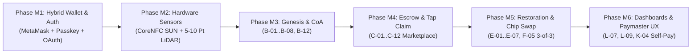

### Phase M1: Hybrid Web2 + Web3 Identity & MetaMask Integration (`UC-A`)
* **Objective:** Unify Email/Password, Google Sign-In, Apple Sign-In, Face ID App Lock, Passkey Smart Wallet (`A-01`), and MetaMask Mobile EOA (`SIWE` + `WalletConnect v2`).
* **Deliverables (Core Prototype Implemented Today):**
  * `LoginScreen`: "Continue with Google", "Sign in with Apple", and **"Continue with MetaMask (SIWE)"**.
  * `WalletService` & `WalletScreen`: Multi-provider wallet switcher (**MetaMask Mobile EOA**, **Passkey Smart Wallet ERC-4337**, **Safe Multisig**), WalletConnect v2 URI/QR generator, account linking to Google/Apple profiles, and interactive **Role-by-Role MetaMask Signing Sheet**.
  * **Next Step for Production:** Integrate `reown_appkit` (WalletConnect v2 Flutter SDK) and `web3dart` for live `metamask://wc` app-switch callbacks on physical iOS devices.
* **Exit Criteria:** User can sign in via Google or MetaMask, unlock via Face ID, link a MetaMask wallet to their profile, and sign EIP-712 payloads per role.

### Phase M2: Hardware Sensor Pipeline — CoreNFC NTAG 424 DNA & 5–10 Point LiDAR Scanner (`UC-B`, `UC-D`)
* **Objective:** Upgrade physical capture from prototype simulation to production NTAG 424 DNA NDEF SUN parsing and guided 5–10 micro-point macro + LiDAR capture.
* **Deliverables:**
  * `NfcService` (`app/lib/services/nfc_service.dart`): Parse dynamic NDEF URL `https://verify.arthentic.io/?uid=...&ctr=...&cmac=...` from NTAG 424 DNA tags (`D-01`), plus Gallery NFC Chip Provisioning writer (`B-05`) that reads UID, computes `chipIdHash = keccak256(uid)`, checks `chipBound[chipIdHash]` on-chain, and provisions AES-128 SUN keys.
  * `ScanScreen` (`app/lib/features/scan/scan_screen.dart`): Configurable 5-to-10 micro-point coordinate guide (`B-02`, `D-05`, `E-02`) with real-time ARKit `sceneDepth` quality gates (focus score, illumination check, distance 15–25 cm, tilt `< 5°`, steadiness).
  * `StatusBadgeWidget` (`D-15*`): Renders `Clear` (Green), `Destroyed` (Red — blocks purchase), `Flagged` (Orange), `Chip-Replaced` (Info), and `Unsynchronized Ownership` (`C-12` Warning).

### Phase M3: Artwork Intake, Artist EIP-712 Co-Signature & Certificate of Authenticity (`UC-B`)
* **Objective:** Implement the multi-actor Genesis workflow between Gallery (`VERIFIER_ROLE`), Artist (`ARTIST_ROLE`), and Public Viewer.
* **Deliverables:**
  * **Gallery Intake Screen (`B-01`, `B-04`, `B-05`):** Form for artwork title, medium, dimensions (`width_cm`, `height_cm`), year, condition notes, front/back photos, artist accreditation check (`hasRole(ARTIST_ROLE, artist)`), Arweave/IPFS upload status, and NFC chip binding check.
  * **Artist Genesis Co-Signature Screen (`B-07`):** Displays human-readable EIP-712 summary (`title`, `genesisVectorHash`, `chipIdHash`, `5% ERC-2981 royalty`) for the Artist to sign via MetaMask (`eth_signTypedData_v4`) or Passkey.
  * **Certificate of Authenticity Screen (`B-12`):** Publicly accessible view verifying that `keccak256(metadata) == onchain.genesisHash(tokenId)` and displaying an integrity warning if mismatched.

### Phase M4: Escrow Marketplace, Unsynchronized Ownership Check & NFC Tap Claim (`UC-C`)
* **Objective:** Build the phygital trade lifecycle where funds stay locked in `ArthenticEscrow` until physical arrival is proven by an NFC tap.
* **Deliverables:**
  * **Create / Cancel / Resale Listing Screens (`C-01`, `C-03*`, `C-10`):** Artist or Collector sets price (ETH/USDC) and expiry timestamp; `C-10` enforces a recent L1/L2 verification check before allowing resale.
  * **Secondary Buyer Pre-Purchase Check (`C-12`) & Escrow Deposit (`C-04`):** Compares `ArthenticNFT.ownerOf(tokenId)` directly from Base L2 RPC against the seller's wallet address; displays a prominent red banner (`"Unsynchronized Ownership: Do Not Pay Off-Chain"`) if mismatched, or unlocks `deposit(listingId)` via MetaMask / Passkey.
  * **Tap Claim Screen (`C-06`):** Buyer taps the arrived painting's NFC chip -> app sends SUN token to Protocol Node -> receives short-lived EIP-712 `Attestation` (`purpose = claim`) -> submits `claim(listingId, attestation, sig)` -> triggers atomic NFT transfer + 95% seller payout + 5% artist royalty payout.

### Phase M5: Restoration Workflow & 3-of-3 Chip Replacement Tracker (`UC-E`, `UC-F`)
* **Objective:** Support post-sale physical lifecycle events without mutating `genesisHash`.
* **Deliverables:**
  * **Restoration Flow (`E-01`–`E-07*`):** Collector selects accredited Conservator and submits damage description (`E-01`); Conservator accepts job, performs restoration, re-scans micro-points (`E-02`), uploads before/after report to Arweave (`E-04`), and requests **Owner Consent (`E-07*`)**; Collector signs EIP-712 consent in MetaMask; Conservator submits `updateCondition()` (`E-03`); public/users view side-by-side Genesis vs. Restoration History (`E-06`).
  * **Chip Replacement 3-of-3 Tracker (`F-05`):** When a chip is damaged, Gallery performs L2 optical scan (`>= 8800 bps`), provisions a new NTAG 424 DNA chip (`newChipIdHash`), and collects **3 EIP-712 approvals** (`Collector`, `Artist`, `Verifier`) shown in a live progress tracker (`1/3` -> `2/3` -> `3/3`) before executing `replaceChip()`.

### Phase M6: Role Dashboards (`L-07`, `L-09`) & Paymaster Self-Pay Fallback (`K-04`)
* **Objective:** Deliver tailored portfolio analytics and resilient gas handling.
* **Deliverables:**
  * **Artist Dashboard (`L-07`):** Minted works, active listings, and cumulative 5% ERC-2981 royalty earnings from `ClaimCompleted` events.
  * **Collector Dashboard (`L-09`):** Owned works, active escrow deals (with shipment tracking & countdown to expiry/refund), and L1/L2 verification log.
  * **Self-Pay Gas Fallback Modal (`K-04`):** Whenever a user's Paymaster quota (`K-02`) is exhausted, the function is not in the `T1–T3` allow-list (`K-01`), or the Paymaster deposit is empty (`K-03`), the app estimates Base L2 gas (~`\$0.01`) and prompts the user to approve self-paid gas via MetaMask or Smart Wallet.

---

## 3. Comprehensive Phase-by-Phase Implementation Plan — Other Side of the Architecture

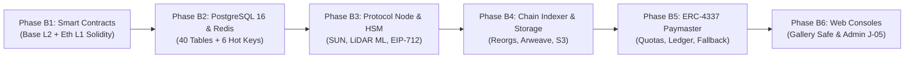

### Phase B1: Smart Contract Layer (`contracts/` — Base L2 & Ethereum L1)
* **Stack:** Solidity `^0.8.24`, Foundry (`forge`), OpenZeppelin Upgradeable v5 (`UUPSUpgradeable`, `ERC721URIStorageUpgradeable`, `ERC2981Upgradeable`, `AccessControlUpgradeable`, `PausableUpgradeable`, `ReentrancyGuard`).
* **Contracts to Implement (per Class Diagram 1, Page 12 of UML PDF):**
  1. **`Roles.sol` (Library):** Defines `ARTIST_ROLE`, `VERIFIER_ROLE`, `CONSERVATOR_ROLE`, `PROTOCOL_NODE_ROLE`, `ANCHORER_ROLE`.
  2. **`AttestationVerifier.sol` (Abstract):**
     * Constants: `MIN_SIMILARITY_BPS = 8800`, `ATTESTATION_TYPEHASH`.
     * State: `mapping(uint256 => bool) public usedNonce`.
     * Internal `_verifyAttestation(Attestation calldata a, bytes calldata sig, bool requireOptical)`: checks `block.timestamp <= a.deadline` (`ATTESTATION_EXPIRED`), `!usedNonce[a.nonce]` (`REPLAY`), `requireOptical => a.similarityBps >= 8800` (`SIMILARITY_BELOW_THRESHOLD`), recovers EIP-712 signer and checks `hasRole(PROTOCOL_NODE_ROLE, signer)` (`INVALID_SIGNER`), then marks `usedNonce[a.nonce] = true`.
  3. **`ArthenticNFT.sol` (Base L2 — UUPS Upgradeable):**
     * State: `_nextTokenId`, `chipBound[bytes32]`, `genesisHash[uint256]` (immutable per token), `activeChip[uint256]`, `destroyed[uint256]`.
     * Functions: `genesisMint()` (`onlyRole(VERIFIER_ROLE)`), `recordVerification()`, `updateCondition()` (`onlyRole(CONSERVATOR_ROLE)`), `replaceChip()` (`onlyRole(VERIFIER_ROLE)` + `_checkThreeApprovals`), `markDestroyed()`, `pause()` / `unpause()` (`onlyRole(DEFAULT_ADMIN_ROLE)`).
  4. **`ArthenticEscrow.sol` (Base L2 — Pausable, ReentrancyGuard):**
     * Struct `Listing { address seller; address buyer; uint256 tokenId; uint256 price; uint64 expiry; Status status; }` where `enum Status { Listed, Funded, Completed, Refunded, Cancelled }`.
     * Functions: `createListing()`, `cancelListing()` (`C-03`), `deposit()` (`payable`), `claim()` (`nonReentrant` — sets effects before interactions, calls `nft.royaltyInfo(tokenId, price)` to split 5% to Artist and 95% to Seller), `refund()` (when `block.timestamp > expiry` and status is `Funded`).
  5. **`MerkleAnchor.sol` (Ethereum L1):**
     * Function `anchorRoot(bytes32 root, uint64 fromBlock, uint64 toBlock)` (`onlyRole(ANCHORER_ROLE)`), emits `RootAnchored(root, fromBlock, toBlock, block.timestamp)`.

### Phase B2: Planned Database Architecture — 40 PostgreSQL 16 Tables & 6 Redis Hot Keys (`server/db/`)
* **Stack:** PostgreSQL 16 (with `uuidv7()`, `citext`, `bytea`, `numeric(78,0)` for `uint256`, row-level security, monthly range partitioning, and immutability triggers) + Redis 7.
* **6 Database Domains (40 Tables per Part 2 of Sequence & DB PDF):**
  * **Domain 1 — Identity & Access (7 tables):** `users`, `wallets` (`smart_wallet`, `safe`, `eoa`/MetaMask), `institutions`, `roles`, `role_grants`, `artist_applications`, `notifications`.
  * **Domain 2 — Artwork, Genesis & Chips (10 tables):** `stored_files`, `artworks` (with `forbid_genesis_change()` trigger), `intake_dossiers`, `artwork_files`, `scan_sessions`, `scan_points`, `feature_vectors`, `nfc_chips` (with `one_active_chip` partial unique index and KMS envelope-encrypted `uid_enc`), `chip_replacements`, `chip_approvals`.
  * **Domain 3 — Marketplace & Escrow (3 tables):** `listings` (with state-transition trigger), `payments`, `shipments`.
  * **Domain 4 — Verification, Attestation & Provenance (8 tables):** `verification_requests`, `sun_validations`, `attestations` (with `CHECK (purpose <> 'l2' OR similarity_bps >= 8800)`), `verification_records`, `chain_events`, `provenance_events`, `merkle_batches`, `indexer_cursors`.
  * **Domain 5 — Restoration (4 tables):** `restoration_requests`, `restoration_reports`, `owner_consents`, `condition_updates`.
  * **Domain 6 — Governance, Paymaster & Audit (8 tables):** `signer_keys`, `incidents`, `incident_actions`, `audit_log` (`REVOKE UPDATE, DELETE`), `paymaster_policies`, `user_quotas`, `sponsored_txs`, `paymaster_balance_snapshots`.
* **6 Redis Hot-Path Keys:**
  1. `sun:ctr:{chipId}` -> monotonic SUN replay guard before DB write.
  2. `nonce:{nonce}` -> `SET NX` reservation with TTL `deadline + margin` at EIP-712 signing time.
  3. `quota:{wallet}:{policyId}:{periodStart}` -> atomic Paymaster per-user quota counter (`K-02`).
  4. `rl:verify:{ipHash}` -> 1-minute sliding window rate limit for wallet-less verification (`D-14*`).
  5. `pm:balance` -> 30-second cached Paymaster deposit status (`ok | warning | empty`, `K-03`).
  6. `idx:head:{chainId}` -> latest indexed block number for liveness monitoring.

### Phase B3: Protocol Node Service & HSM/KMS Security Layer (`node/`)
* **Responsibilities (`SC-NODE-01`, `SC-NODE-02`):**
  * **Key Isolation:** Node `PROTOCOL_NODE_ROLE` ECDSA private key and per-chip AES-128 keys never touch PostgreSQL or application memory; `nfc_chips.key_ref` and `signer_keys.hsm_key_ref` reference AWS KMS / HashiCorp Vault Transit / CloudHSM handles.
  * **SUN Validator (`D-02`):** Verifies AES-128 CMAC over `uid || counter`, checks `counter > sun:ctr:{chipId}` in Redis and `UPDATE nfc_chips SET last_sun_counter = :c WHERE id = :id AND last_sun_counter < :c` in PostgreSQL, and computes `sunDigest = keccak256(uid, counter, cmac)`.
  * **Optical Feature Extractor & Cosine Similarity (`B-03`, `D-06`):** Extracts 384-D weave + crack + LiDAR depth relief vector across 5–10 micro-points, verifies `keccak256(stored_genesis_vector) == onchain.genesisHash(tokenId)`, applies ageing tolerance, and enforces `similarityBps >= 8800`.
  * **EIP-712 Attestation Signer (`I-01`, `I-02`):** Reserves unique random `uint256 nonce` via Redis `SET NX`, sets short deadline (`now + 300s`), signs EIP-712 `Attestation` digest via HSM, and persists to `attestations`.

### Phase B4: Reorg-Safe Chain Event Indexer, Storage & L1 Merkle Anchoring (`indexer/`)
* **Event Indexer (`SD-12`):** Subscribes to `ArthenticNFT` and `ArthenticEscrow` on Base L2 and `MerkleAnchor` on Ethereum L1. Writes raw logs idempotently to `chain_events` keyed by `(chain_id, tx_hash, log_index)` with `finalized = false`. Once confirmation depth is reached, marks `finalized = true`; if a block hash mismatch (reorg) is detected, rolls back unfinalized rows and replays.
* **L1 Merkle Batch Worker (`SD-10`, `H-05`):** Runs every 24 hours or every 1,000 finalized `provenance_events` where `merkle_batch_id IS NULL`. Builds Merkle tree over `leaf_hash`, checks Ethereum L1 gas fee against threshold (defers batch if L1 gas spikes), calls `MerkleAnchor.anchorRoot(root, fromBlock, toBlock)`, and updates `merkle_batches` and `provenance_events`.
* **Reconciliation Job (`2.4`):** Periodically compares `ownerOf(tokenId)`, `genesisHash(tokenId)`, and escrow status on Base L2 with PostgreSQL cache, healing any drift in favor of the chain and raising a `J-05` incident if an anomaly is found.

### Phase B5: ERC-4337 Paymaster & MetaMask Gas Relayer (`paymaster/`)
* **Sponsorship Policy (`K-01`, `K-02`):** Evaluates incoming `UserOperation` (or ERC-2771 meta-transaction for MetaMask EOAs) against `paymaster_policies` (`contract_address`, `function_selector`) for Tiers `T1` (`claim`, `deposit`), `T2` (`createListing`, `updateCondition`), and `T3` (`recordVerification`), and checks `user_quotas` in Redis.
* **Balance Monitor & Cost Ledger (`K-03`, `K-05`):** Polls `EntryPoint.getDeposit()` every few minutes, writes `paymaster_balance_snapshots`, alerts Admin if below `lowBalanceThreshold`, and logs every sponsored tx to `sponsored_txs` with `gas_used`, `cost_wei`, and `cost_usd`.

### Phase B6: Web Consoles — Gallery/Conservator Portal & Protocol Admin Console (`web/`)
* **Gallery & Conservator Web Console:** Connects to Gnosis Safe (`Safe{Wallet}` SDK + MetaMask signer) for multi-signature execution of `genesisMint()` (`B-08`) and `replaceChip()` (`F-05`), plus bulk verification reports.
* **Protocol Admin Console:**
  * Accreditation Approval Queue (`A-06` `ARTIST_ROLE`, `A-07` `VERIFIER_ROLE`, `CONSERVATOR_ROLE`) signed via Admin Safe Multisig.
  * **Security Incident Dashboard (`J-05`, `SD-11`):** Real-time stream of replay bursts, failed claims, and signer anomalies with 1-click Safe proposals for emergency `pause()` (`J-01`), `revokeRole(PROTOCOL_NODE_ROLE, compromisedKey)` (`A-10`), and `grantRole(PROTOCOL_NODE_ROLE, newHsmKey)` (`A-09`).

---

## 4. Catatan Prototype #1: MetaMask Wallet Architecture & Role-by-Role Flows

### 4.1 How MetaMask Fits into the Arthentic Architecture

While the original UML (`A-01`) introduced Passkey ERC-4337 Smart Wallets (`smart_wallet`) and Gnosis Safe Multisigs (`safe`), the database architecture (`ERD 1: wallets.wallet_type`) explicitly includes **`eoa` (Externally Owned Accounts)** to support **MetaMask Mobile & Browser Extension**.

In our prototype and production architecture, **MetaMask operates in three modes** depending on the actor's role:
1. **Direct EOA Mode (Collector, Secondary Buyer, Artist, Conservator):** User connects MetaMask Mobile via WalletConnect v2 (`metamask://wc`) or signs in with Ethereum (`SIWE`, EIP-4361). MetaMask signs off-chain EIP-712 typed data (`eth_signTypedData_v4` — **0 gas**) and submits on-chain Base L2 transactions (`eth_sendTransaction`).
2. **Sponsored Meta-Transaction / ERC-4337 Wrapper Mode (Collector, Artist):** For gas-sponsored actions (`T1–T3`), MetaMask signs an EIP-712 intent/UserOp or uses self-pay fallback (`K-04`, ~`\$0.005–\$0.02` on Base L2).
3. **Safe Multisig Signer Mode (Gallery Verifier, Protocol Admin):** Institutional actors hold roles (`VERIFIER_ROLE`, `DEFAULT_ADMIN_ROLE`) in a **Gnosis Safe Multisig**, where each individual committee member uses their **MetaMask wallet** as an owner signer (`2-of-3` or `3-of-5` threshold) to approve `genesisMint()`, `replaceChip()`, `grantRole()`, or `pause()`.

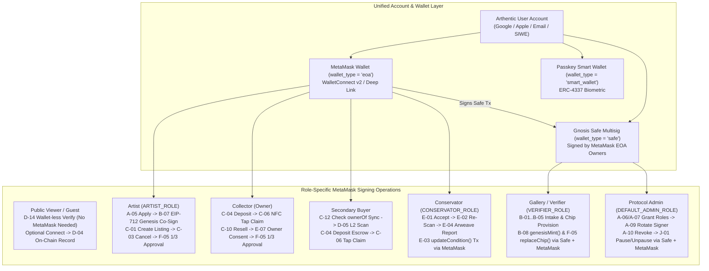

### 4.2 Detailed MetaMask Flow for Every Role

#### Role 1: Public Viewer / Guest (`No Wallet Required -> Optional MetaMask Upgrade`)
* **Core Principle (`D-14*`, `SD-05`):** A museum visitor or prospective buyer can open the Arthentic app **without logging in and without MetaMask**, tap the painting's NFC chip (`D-01`), validate the SUN counter/CMAC (`D-02`), run a Level 2 optical scan (`D-05`), inspect status badges (`D-15*`), and read the Certificate of Authenticity (`B-12`) and Provenance Timeline (`H-03`) for **0 gas**.
* **MetaMask Upgrade Path (`D-04`):** If the viewer wants to permanently anchor their verification on Base L2 (`recordVerification(attestation, sig, requireOptical)`), they tap **"Connect MetaMask to Record On-Chain"** -> sign SIWE -> submit `recordVerification()`.

#### Role 2: Artist (`ARTIST_ROLE`) — From Accreditation to Genesis Co-Sign & Primary Listing
1. **Onboarding & Accreditation (`A-05`, `SD-01`):**
   * Artist signs in (via Google or `"Continue with MetaMask"`), links their MetaMask EOA (`0xArtist...`), and submits their portfolio in `POST /artist-applications`.
   * Protocol Admin approves and grants `ARTIST_ROLE` to `0xArtist...` on `ArthenticNFT`.
2. **Genesis Co-Signature (`B-07`, `SD-02`):**
   * After the Gallery completes intake (`B-01`), 5–10 point optical scan (`B-02`), Arweave upload (`B-04`), and NFC chip provisioning (`B-05`), the Artist receives a notification in the Arthentic App.
   * The Artist reviews the human-readable EIP-712 payload (`title`, `genesisVectorHash`, `chipIdHash`, `royaltyBps = 500` [5%]) and taps **"Sign via MetaMask"**.
   * Arthentic invokes `eth_signTypedData_v4` in MetaMask (**gasless off-chain signature**). Once signed, the Gallery's `genesisMint()` button is unlocked, and the NFT is minted directly to the Artist's MetaMask wallet (`0xArtist...`).
3. **Primary Listing & Cancellation (`C-01`, `C-03*`, `SD-03`):**
   * On the Artist Dashboard (`L-07`), the Artist selects their work, sets `price` (in ETH/USDC) and `expiry`, and signs `approve(escrow, tokenId)` + `createListing(tokenId, price, expiry)` in MetaMask.
   * If no buyer has deposited yet (`status == Listed`), the Artist can sign `cancelListing(listingId)` (`C-03*`) in MetaMask to reclaim the NFT.
4. **Automatic Royalty Collection (`C-06`, `L-07`):**
   * Every time the artwork is claimed in `ArthenticEscrow.claim()` (both primary and secondary resales), `ArthenticEscrow` queries `ERC2981.royaltyInfo(tokenId, salePrice)` and transfers **5% of the sale price directly to the Artist's MetaMask wallet** in the same atomic transaction.

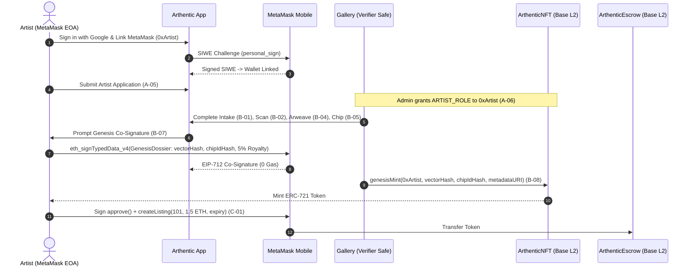

#### Role 3: Collector (Primary Buyer / Current Owner) & Role 4: Secondary Buyer
1. **Pre-Purchase Ownership Synchronization Check (`C-12`, `SD-03`):**
   * When a **Secondary Buyer** inspects a physical painting in person, they tap the NFC chip (`D-01`) and optionally run an L2 optical scan (`D-05`).
   * The app resolves `tokenId` from `chipIdHash`, calls `ArthenticNFT.ownerOf(tokenId)` on Base L2, and compares it with the seller's wallet address. If they do not match, the app blocks off-chain payment with an **"Unsynchronized Ownership"** warning (`C-12`).
2. **Deposit to Escrow (`C-04`, `SD-04`):**
   * Buyer opens the listing, taps **"Deposit to Escrow with MetaMask"**, and confirms `ArthenticEscrow.deposit(listingId) {value: price}` in MetaMask.
   * Contract locks the funds and sets `status = Funded`. Seller ships the physical painting (`shipments` table tracks carrier & tracking number).
3. **Physical Arrival & NFC Tap Claim (`C-06`, `SD-04`):**
   * When the painting arrives, the Buyer taps the NTAG 424 DNA chip with their iPhone.
   * The app sends `{sunToken, tokenId}` to the Protocol Node (`POST /attest`).
   * The Protocol Node validates the AES-128 CMAC and monotonic counter (`D-02`) and returns a signed EIP-712 `Attestation(tokenId, sunDigest, similarityBps, deadline, nonce)` (`I-01`, `I-02`).
   * The Buyer approves `ArthenticEscrow.claim(listingId, attestation, sig)` via MetaMask (sponsored by Paymaster `T1` or direct Base L2 gas).
   * `ArthenticEscrow` verifies `status == Funded`, `msg.sender == buyer`, verifies the Node's EIP-712 signature and `nonce`, marks `usedNonce[nonce] = true`, sets `status = Completed`, transfers the ERC-721 NFT to the Buyer's MetaMask wallet, pays `95%` to Seller, and pays `5%` royalty to the Artist!
   * **Timeout Protection:** If the seller never ships and `block.timestamp > expiry`, the Buyer calls `refund(listingId)` via MetaMask to recover 100% of their locked ETH/USDC while the NFT returns to the seller.

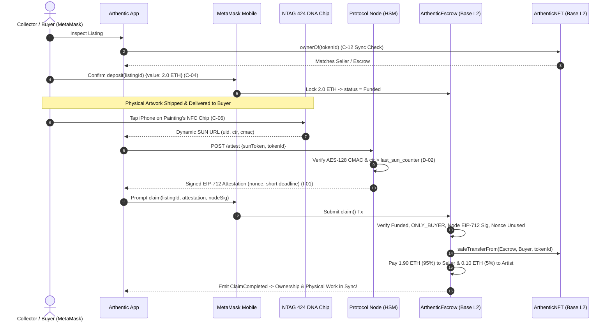

#### Role 5: Gallery / Verifier (`VERIFIER_ROLE`) — Institutional Safe + MetaMask Signer
* Galleries hold `VERIFIER_ROLE` inside a **Gnosis Safe Multisig** (`institutions.safe_wallet_id`).
* On mobile (`Arthentic App`), Gallery staff perform field operations: Artwork Intake (`B-01`), Guided 5–10 Point Optical Scan (`B-02`), NFC Chip Provisioning (`B-05`), and Batch Verification (`GET/POST /v1/gallery/*`).
* For high-stakes on-chain mutations — **`genesisMint()` (`B-08`)** and **`replaceChip()` (`F-05`)** — Gallery directors connect their **MetaMask wallet** as a Safe owner signer to collect the threshold signatures and execute the transaction on `ArthenticNFT`.

#### Role 6: Conservator (`CONSERVATOR_ROLE`) — Restoration & Condition Updates (`SD-07`)
1. Collector submits a restoration request (`E-01`) selecting an accredited Conservator (`hasRole(CONSERVATOR_ROLE, conservator) == true`).
2. Conservator reviews the artwork's Genesis record and past `ConditionUpdated` events (`E-06`) and accepts the job (`status = UnderRestoration`).
3. After physical conservation work, the Conservator uses the Arthentic Scanner App to re-scan the 5–10 micro-points (`E-02`), generating `newVectorHash`, and uploads the treatment report and before/after photos to Arweave/IPFS (`E-04` -> `noteURI`).
4. **Owner Consent Gate (`E-07*`):** The Collector receives a notification, reviews the report and `newVectorHash`, and signs an EIP-712 `OwnerConsent` approval in MetaMask.
5. **On-Chain Condition Update (`E-03`):** Once owner consent is attached, the Conservator signs `ArthenticNFT.updateCondition(tokenId, newVectorHash, noteURI)` in MetaMask. The smart contract verifies `CONSERVATOR_ROLE` and `!destroyed[tokenId]`, leaves `genesisHash[tokenId]` untouched, and emits `ConditionUpdated(tokenId, newVectorHash, conservator, noteURI, block.timestamp)`.

#### Role 7: Protocol Admin (`DEFAULT_ADMIN_ROLE`) — Governance, Role Grants & Incident Response (`SD-11`)
* Protocol Admins operate through an institutional **Safe Multisig + Timelock** using MetaMask EOA signers:
  * **Role Management (`A-06`, `A-07`, `A-10`):** Sign `grantRole(ARTIST_ROLE, artistWallet)`, `grantRole(VERIFIER_ROLE, gallerySafe)`, `grantRole(CONSERVATOR_ROLE, conservatorWallet)`, or `revokeRole(...)`.
  * **Emergency Incident Response (`J-05`, `J-01`, `A-09`, `SD-11`):** If the Event Monitor detects a replay burst or Node signer anomaly (`J-05`), Admins use MetaMask + Safe to:
    1. Call `pause()` on `ArthenticNFT` and `ArthenticEscrow` (`J-01`).
    2. Call `revokeRole(PROTOCOL_NODE_ROLE, compromisedSigner)` (`A-10`).
    3. Provision a fresh HSM key and call `grantRole(PROTOCOL_NODE_ROLE, newSigner)` (`A-09`).
    4. Verify test attestation and call `unpause()`.

### 4.3 Summary Matrix: MetaMask Operations Across All Roles

| Role | On-Chain Role Constant | Wallet Type | Key MetaMask Signatures / Transactions | Gas Model |
|---|---|---|---|---|
| **Public Viewer / Guest** | None | None (or optional MetaMask EOA) | Optional `D-04` `recordVerification()` | Free off-chain (`D-14*`); Paymaster `T3` or Self-Pay on-chain |
| **Artist** | `ARTIST_ROLE` | MetaMask EOA (`eoa`) or Passkey (`smart_wallet`) | `B-07` Genesis Co-Sign (`EIP-712`), `C-01` `createListing()`, `C-03` `cancelListing()`, `F-05` Chip Replace Approval (`1/3 EIP-712`) | `0 Gas` for `B-07` & `F-05`; Sponsored `T2` or Self-Pay (`~$0.01`) for `C-01`/`C-03` |
| **Collector** | Implicit (Token Owner) | MetaMask EOA (`eoa`) or Passkey (`smart_wallet`) | `C-04` `deposit()`, `C-06` `claim()`, `C-10` Resale `createListing()`, `D-04` `recordVerification()`, `E-07` Owner Consent (`EIP-712`), `F-05` Chip Approval (`1/3 EIP-712`) | `0 Gas` for `E-07` & `F-05`; Sponsored `T1` for `C-06`; Value + Gas for `C-04` |
| **Secondary Buyer** | None (becomes Collector on `C-06`) | MetaMask EOA (`eoa`) or Passkey (`smart_wallet`) | `C-12` `ownerOf()` sync check, `C-04` `deposit()`, `C-06` `claim()` | Free RPC check (`C-12`); Value + Gas (`C-04`); Sponsored `T1` (`C-06`) |
| **Gallery / Verifier** | `VERIFIER_ROLE` | Safe Multisig (`safe`) signed by MetaMask EOAs | `B-08` `genesisMint()`, `F-05` `replaceChip()` (1/3 approval + Safe execution) | Gallery Safe Treasury / Sponsored `T2` |
| **Conservator** | `CONSERVATOR_ROLE` | MetaMask EOA (`eoa`) | `E-03` `updateCondition(tokenId, newVectorHash, noteURI)` | Sponsored `T2` or MetaMask Self-Pay |
| **Protocol Admin** | `DEFAULT_ADMIN_ROLE` | Safe Multisig + Timelock (`safe`) signed by MetaMask EOAs | `A-06`/`A-07` `grantRole()`, `A-09` Rotate Node Signer, `A-10` `revokeRole()`, `J-01` `pause()`/`unpause()`, `K-03` Paymaster Top-Up | Protocol Admin Treasury |

---

## 5. Catatan Prototype #2: Other Auth & Account Features (Google, Apple, Biometrics & Multi-Identity Linking)

Arthentic implements a **Defense-in-Depth Hybrid Identity Architecture** so mainstream art collectors and artists enjoy Web2 simplicity while retaining full Web3 self-custody:

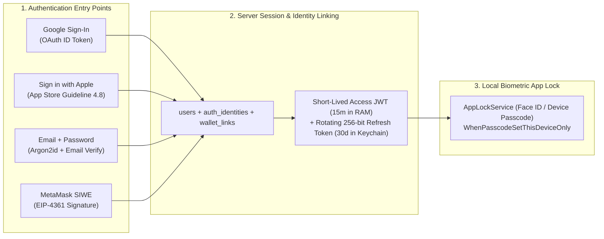

1. **Google Sign-In & Sign in with Apple (`POST /auth/google`, `POST /auth/apple`):**
   * Verifies `id_token` signature, `aud`, `iss`, `exp`, and `email_verified`.
   * **Anti-Takeover Auto-Linking Rule:** Automatically links a Google/Apple identity to an existing email account **only** when both the OAuth token's `email_verified == true` and the existing account's `email_verified_at IS NOT NULL`.
2. **Multi-Identity & Wallet Linking (`POST /auth/link`, `POST /v1/auth/metamask/link`):**
   * A single user (`users.id`) can link Google + Apple + Email (`auth_identities`) **and** link multiple wallets (`wallet_links` / `wallets`: e.g., a Passkey Smart Wallet for everyday gasless taps + a MetaMask EOA for high-value escrow trades).
3. **Biometric App Lock (`AppLockService` — Face ID / Passcode):**
   * Refresh tokens are stored in iOS Keychain with `kSecAttrAccessibleWhenPasscodeSetThisDeviceOnly` (never backed up to iCloud, wiped if device passcode is removed).
   * Every cold start or background resume after the grace period (default 30s) requires Face ID or device passcode unlock, while blurring the app-switcher snapshot on `inactive`.
4. **Account Security & Compliance (`M6`):**
   * Active device/session management with remote revocation (`GET /auth/sessions`, `POST /auth/sessions/{id}/revoke`), Refresh Token Family Reuse Detection (automatic revocation of entire token family if a stolen token is replayed), In-App Account Deletion (`DELETE /auth/account` — anonymizes PII while preserving immutable on-chain provenance), and Security Audit Log (`GET /auth/audit-log`).

---

## 6. Catatan Prototype #3: Smart Contract Architecture & Execution Flows (`Alur Smart Contract`)

### 6.1 Smart Contract Architecture Diagram (Base L2 & Ethereum L1)

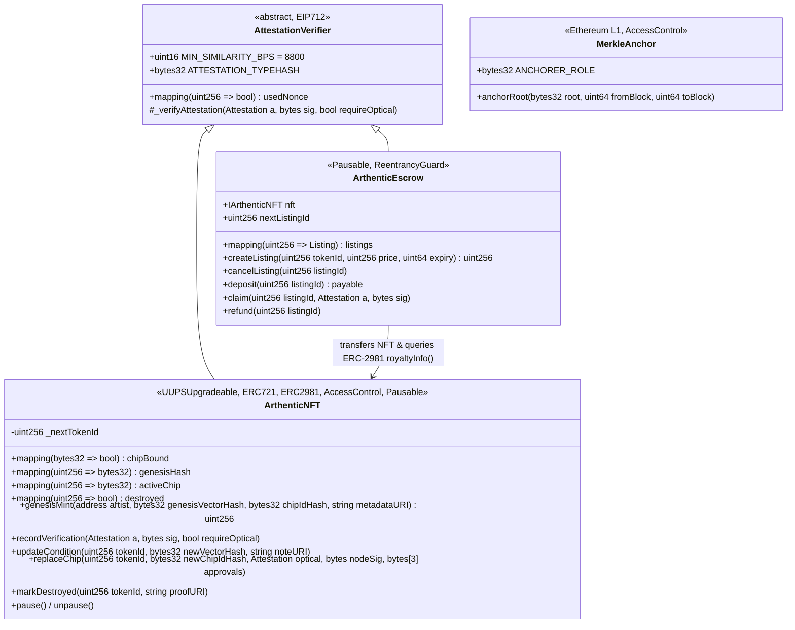

### 6.2 Core Smart Contract State Machines & Flows

#### Flow 1: EIP-712 `Attestation` Verification (`AttestationVerifier.sol`)
Every physical interaction (L1 NFC tap `D-01`, L2 optical scan `D-05`, Tap Claim `C-06`, Chip Replacement `F-05`) relies on a single unified EIP-712 struct signed by the Protocol Node's HSM key (`PROTOCOL_NODE_ROLE`):

$$\text{digest} = \text{keccak256}\left(\texttt{"\textbackslash x19\textbackslash x01"} \;\|\; \text{DOMAIN\_SEPARATOR} \;\|\; \text{keccak256}(\text{encode}(a))\right)$$

where:
```solidity
struct Attestation {
    uint256 tokenId;
    bytes32 sunDigest;      // keccak256(abi.encodePacked(uid, counter, cmac))
    uint16  similarityBps;  // 0 for L1 NFC; 8800..10000 for L2 Optical
    uint64  deadline;       // short validity window (e.g. block.timestamp + 300s)
    uint256 nonce;          // single-use anti-replay nonce
}
```
On-chain checks executed atomically inside `_verifyAttestation`:
1. `if (block.timestamp > a.deadline) revert ATTESTATION_EXPIRED();`
2. `if (usedNonce[a.nonce]) revert REPLAY();`
3. `if (requireOptical && a.similarityBps < MIN_SIMILARITY_BPS) revert SIMILARITY_BELOW_THRESHOLD();`
4. `address signer = ECDSA.recover(_hashTypedDataV4(structHash), sig);`
5. `if (!hasRole(PROTOCOL_NODE_ROLE, signer)) revert INVALID_SIGNER();`
6. `usedNonce[a.nonce] = true;` (Effects before interactions!).

#### Flow 2: Escrow State Machine (`ArthenticEscrow.sol`)

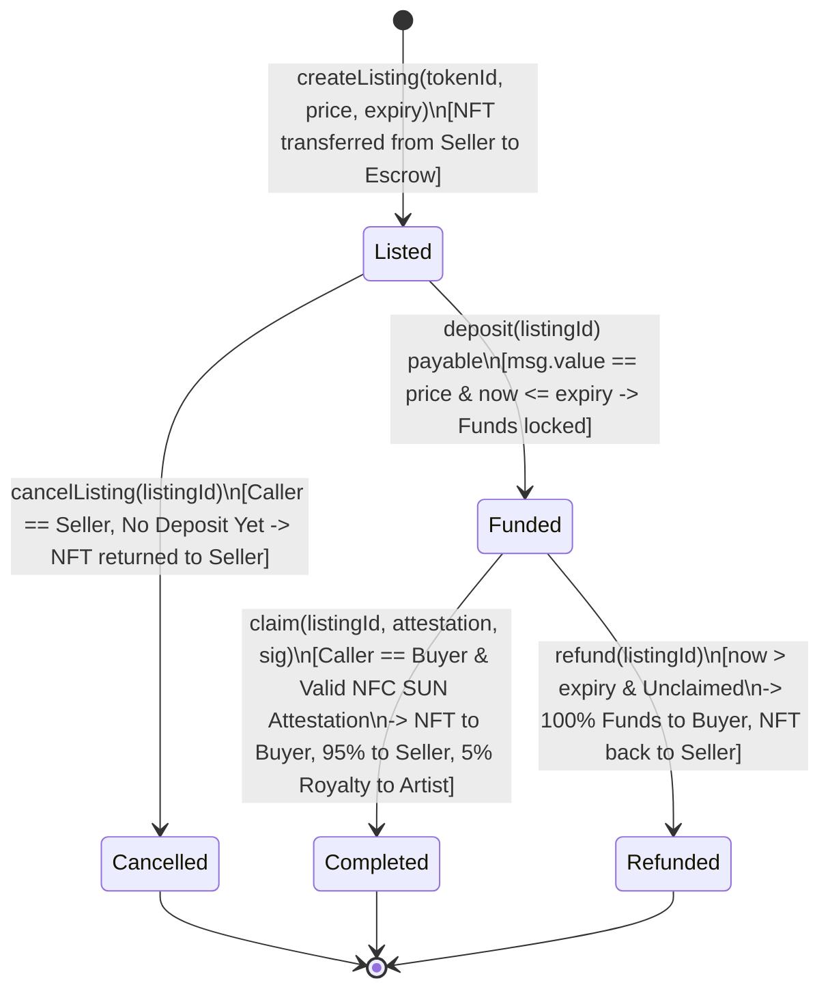

#### Flow 3: Chip Replacement 3-of-3 Multi-Signature Guard (`F-05`)
To prevent an attacker or rogue gallery from swapping a genuine painting's NFC chip onto a forgery:
1. `replaceChip(tokenId, newChipIdHash, opticalAttestation, nodeSig, approvals[3])` requires `_verifyAttestation(opticalAttestation, nodeSig, true)` proving that the physical canvas still matches the immutable `genesisHash` with **`similarityBps >= 8800` (88.0%)**.
2. It verifies `!chipBound[newChipIdHash]` (`CHIP_ALREADY_BOUND`).
3. It verifies `approvals[0]` (signed by current `ownerOf(tokenId)` — Collector), `approvals[1]` (signed by accredited `VERIFIER_ROLE` — Gallery), and `approvals[2]` (signed by original `ARTIST_ROLE` — Artist).
4. Only when all 3 signatures + optical proof pass does it unbind the old chip, bind `newChipIdHash`, and emit `ChipReplaced(tokenId, newChipIdHash)`.

---

## 7. Catatan Prototype #4: Tokenomics & Physical-to-Digital Supply Chain (`Tokenomics & Supply Chain`)

### 7.1 End-to-End Phygital Supply Chain Architecture

Arthentic uses a **Non-Speculative Utility & Royalty Tokenomics Model** (no volatile protocol governance token required for end-users; all settlements occur in **ETH or USDC on Base L2**, anchored to **Ethereum L1**):

```mermaid
flowchart LR
    subgraph S1["Stage 1: Creation & Tagging"]
        P1["Artist Creates Physical Canvas"] --> P2["Gallery Intake (B-01)\nAttach NTAG 424 DNA Chip (B-05)\n+ 5-10 Pt LiDAR Scan (B-02)"]
    end

    subgraph S2["Stage 2: Genesis Mint"]
        P2 --> P3["Arweave/IPFS Upload (B-04)\n+ Artist EIP-712 Co-Sign (B-07)"]
        P3 --> P4["genesisMint() on Base L2 (B-08)\nERC-721 + 5% ERC-2981 Royalty Bound"]
    end

    subgraph S3["Stage 3: Primary Escrow & Logistics"]
        P4 --> P5["Primary Listing (C-01)\n& Buyer Escrow Deposit (C-04)"]
        P5 --> P6["Insured Physical Shipment\n(shipments table tracking)"]
    end

    subgraph S4["Stage 4: Tap-to-Claim Settlement"]
        P6 --> P7["Buyer Taps NFC Chip on Arrival (C-06)\nAtomic NFT Transfer + 95%/5% Split"]
    end

    subgraph S5["Stage 5: Secondary Lifecycle & L1 Anchor"]
        P7 --> P8["Secondary Resales (C-10)\nPerpetual 5% Artist Royalty\n+ Conservation (E-03) & L1 Merkle Anchor (H-05)"]
    end
```

### 7.2 Value, Fee & Royalty Waterfall across the Supply Chain

| Supply Chain Stage | Triggering On-Chain Event | Value / Asset Flow | Protocol / Network Fee Structure |
|---|---|---|---|
| **1. Hardware & Genesis Enrollment** | `GenesisRegistered(tokenId, artist, genesisVectorHash, chipIdHash)` | Physical NTAG 424 DNA tamper-evident tag bound to ERC-721 token minted to `Artist` wallet. | **Genesis Registration Fee:** \$15–\$35 per artwork (paid by Gallery/Artist; covers NTAG 424 DNA tag, Arweave permanent storage, and Base L2 mint gas). |
| **2. Primary Sale via Escrow** | `ClaimCompleted(listingId, tokenId, buyer)` | **100%** of sale price locked in `ArthenticEscrow`; upon Buyer's physical NFC Tap Claim (`C-06`), NFT transfers to Buyer and funds release to Artist/Gallery. | **Escrow Take-Rate:** 1.5%–2.5% protocol fee (vs. 15%–25% traditional auction house buyer's premium). Gas sponsored by Paymaster (`T1`). |
| **3. Secondary Market Resale** | `ClaimCompleted(listingId, tokenId, secondaryBuyer)` | **95% (`9500 bps`)** -> Seller Wallet (`Collector`)<br>**5% (`500 bps`)** -> Original `Artist` Wallet (enforced at smart-contract level via `ERC-2981` inside `ArthenticEscrow.claim()`). | Perpetual **5% Creator Royalty** cannot be bypassed because buyers require `ArthenticEscrow` Tap Claim to keep on-chain `ownerOf` synchronized with the physical painting (`C-12` guard!). |
| **4. Everyday Verification (L1 / L2)** | `VerificationRecorded(tokenId, level, similarityBps)` | Public wallet-less checks (`D-14*`) are off-chain (`$0.00`). On-chain verification anchoring (`D-04`) is covered by Paymaster up to per-user quota (`K-02`). | **Base L2 Gas Cost:** `~$0.005–$0.02` per `recordVerification()`. Covered by Paymaster `T3` quota (e.g. 5 free on-chain records/month/wallet), then `K-04` Self-Pay fallback. |
| **5. Conservation & Chip Replacement** | `ConditionUpdated` / `ChipReplaced` | Preserves secondary market valuation of restored artworks (`E-03`) and recovers from damaged NFC tags (`F-05`). | **Replacement Kit Fee:** \$25 per replacement NTAG 424 DNA chip + Gallery service fee. |
| **6. Ethereum L1 Merkle Settlement** | `RootAnchored(root, fromBlock, toBlock, timestamp)` | Anchors up to 1,000 Base L2 provenance events into a single `bytes32` Merkle root on Ethereum L1 (`H-05`). | **Amortized L1 Security Cost:** 1 L1 tx (~`\$1.50–\$4.00`) divided across 1,000 events = **`\$0.0015–\$0.004` per provenance event**. |

### 7.3 Why the Supply Chain Enforces Royalties (`C-12` Economic Loop)
A classic failure of standard NFT marketplaces is that buyers and sellers trade off-chain (or via zero-royalty wrappers) to evade the 5% artist royalty. **Arthentic solves this economically through `C-12` (Unsynchronized Ownership Warning):**
* If Seller A sells the physical painting to Buyer B for cash off-chain without executing `ArthenticEscrow.claim()`, the on-chain `ownerOf(tokenId)` remains Seller A.
* Whenever Buyer B (or any future buyer, gallery, or insurer) taps the painting's NFC chip, the Arthentic App displays a **Red/Orange Unsynchronized Ownership Warning (`C-12`)**, proving Buyer B does not hold legal digital title and blocking Buyer B from listing the work on the marketplace (`C-10`) or authorizing conservation (`E-07`).
* Thus, buyers demand settlement through `ArthenticEscrow.claim()`, which **guarantees physical delivery via NFC tap AND enforces the 5% Artist royalty atomically**.

---

## 8. Catatan Prototype #5: Solution Overview (Based on Project Overview)

### 8.1 Core Industry Problems Addressed
1. **Rampant Physical Forgery & Paper COA Tampering:** Paper Certificates of Authenticity (COAs) and simple QR/hologram stickers are trivially forged, detached, or swapped onto high-grade reproductions.
2. **Tag-Swap & Clone Attacks on Standard NFC:** Standard NFC tags (NTAG 213/215) return a static UID that anyone can clone in seconds with a smartphone, and even cryptographic tags can be physically peeled off and glued onto a fake canvas.
3. **Digital-Physical Desynchronization:** Existing art NFTs live purely on-chain with no cryptographic or biometric proof that the holder of the NFT actually possesses the genuine physical canvas, nor any protection during physical shipping.
4. **Web3 UX Friction for the Fine Art World:** Seed phrases, volatile gas tokens, and complex wallet setups alienate galleries, artists, conservators, and collectors.

### 8.2 The Arthentic 3-Layer Phygital Solution

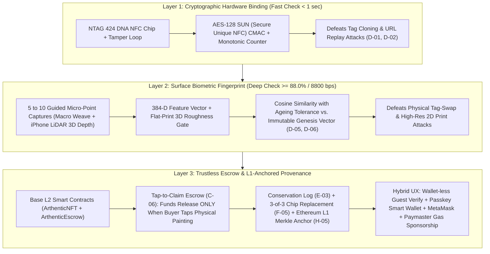

---

## 9. Catatan Prototype #6: Positioning Map of Arthentic

### 9.1 2x2 Strategic Positioning Quadrant
We position Arthentic along two critical industry axes:
* **X-Axis:** *Physical-to-Digital Binding Strength* (From `0 = None / Paper / Static QR` to `100 = Cryptographic NFC SUN + 3D LiDAR/Optical Surface Biometrics`).
* **Y-Axis:** *Provenance Openness & Trustless Settlement* (From `0 = Siloed Private Database / Manual Escrow` to `100 = Public L2/L1 Anchored Blockchain + Atomic Tap-to-Claim Escrow + Enforced Royalties`).

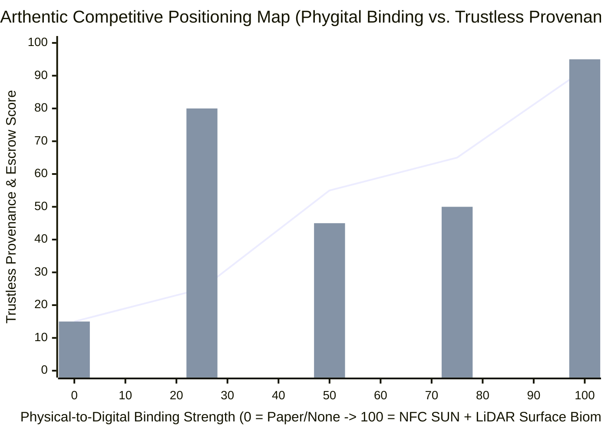

| Quadrant / Coordinate `(X, Y)` | Representative Solutions | Why It Falls Short vs. Arthentic |
|---|---|---|
| **Bottom-Left `(15, 15)` — Legacy Analog** | **Traditional Paper COAs, Gallery Invoices & Physical Catalogues Raisonnes** | Easily forged or lost; zero cryptographic verification; slow manual due diligence; 15%–25% auction house fees; zero secondary artist royalties. |
| **Top-Left `(25, 80)` — Pure Digital Web3** | **Standard NFT Marketplaces (OpenSea, Blur, Foundation)** | Strong on-chain trading for digital files, but **zero binding to physical canvases**, no physical delivery escrow, and royalties have been largely bypassed. |
| **Center `(55, 45)` — First-Gen Art Tagging** | **QR / Basic NFC Art Registries (Verisart, Artory, Simple NFC Stickers)** | Relies on tags alone. If a tag is peeled off or damaged, or if a high-res print is swapped into the frame, there is **no optical/LiDAR surface biometric check (`L2`)** and no Tap-to-Claim escrow. |
| **Center-Right `(65, 50)` — Luxury Private Consortia** | **Closed Luxury Consortium Chains (Aura Blockchain Consortium)** | Built for closed mega-brands on permissioned/private infrastructure; inaccessible to independent artists and galleries; lacks iPhone LiDAR canvas biometrics and open Base L2 escrow. |
| **Top-Right `(92, 95)` — Arthentic (Category Leader)** | **Arthentic Protocol (NTAG 424 DNA + iPhone LiDAR/Optical L2 + Base L2 Tap-to-Claim Escrow + Eth L1 Anchor)** | **Only protocol combining** hardware crypto (`L1`), intrinsic canvas surface biometrics (`L2 >= 88%`), atomic NFC Tap-to-Claim escrow (`C-06`), conservation history (`E-03`), and gasless/MetaMask hybrid UX. |

### 9.2 Multi-Dimensional Feature Comparison Table

| Capability | Paper COA / Auction House | Standard NFT (OpenSea) | Basic NFC Art Tag (e.g. Verisart) | **Arthentic Protocol** |
|---|---|---|---|---|
| **Anti-Clone Cryptographic NFC (NTAG 424 DNA SUN)** | No | No | Partial | **Yes (`D-01`, `D-02`)** |
| **3D LiDAR + Micro-Point Canvas Surface Biometrics** | No | No | No | **Yes (`D-05`, `D-06`, `>= 8800 bps`)** |
| **Survives Tag Damage / Tamper Attempt** | No | N/A | No (Tag loss = identity loss) | **Yes (`F-05` Optical Proof + 3-of-3 Approval)** |
| **Atomic Physical Delivery Escrow (Tap-to-Claim)** | Manual / High Fee | No | No | **Yes (`C-04`, `C-06`)** |
| **Enforced 5% Secondary Artist Royalties** | Rarely (jurisdiction-limited) | Bypassed | No | **Yes (`ERC-2981` + `C-12` Sync Guard)** |
| **Post-Restoration Condition Tracking (`updateCondition`)** | Siloed paper notes | No | No | **Yes (`E-01`–`E-07` with Owner Consent)** |
| **Wallet-less Public Verification (0 Gas)** | No | No | Yes | **Yes (`D-14*` + Paymaster `K-01`)** |
| **Wallet Support** | N/A | EOA only | Custodial / Email | **Hybrid: Passkey ERC-4337 + MetaMask + Safe** |

---

## 10. Catatan Prototype #7: Benefit Plan & Business Plan Presentation

### 10.1 Multi-Stakeholder Benefit Plan (`Value Proposition per Actor`)

| Stakeholder | Key Pain Today | Concrete Benefits with Arthentic | Quantifiable Impact |
|---|---|---|---|
| **1. Artists (`ARTIST_ROLE`)** | Lose all visibility and royalties once a painting leaves the studio; forgery dilutes reputation. | - Cryptographic co-signature (`B-07`) proves authorship forever.<br>- **Automatic 5% ERC-2981 royalty** paid instantly on every secondary sale (`C-06`).<br>- Artist Dashboard (`L-07`) tracks collector provenance globally. | **+5% lifetime recurring revenue** on every secondary resale; **0 upfront gas cost**. |
| **2. Galleries & Auction Houses (`VERIFIER_ROLE`)** | High cost of authentication experts, shipping disputes, and paper COA management. | - Turnkey intake & LiDAR certification workflow (`B-01`–`B-08`).<br>- Safe Multisig institutional security.<br>- Higher buyer conversion via verifiable digital CoA (`B-12`). | **80% reduction** in authentication & escrow dispute overhead; new certification fee stream. |
| **3. Collectors & Secondary Buyers** | Fear of buying sophisticated fakes, off-chain seller fraud, or losing value after restoration. | - Instant L1 NFC tap (`<1s`) + L2 LiDAR surface scan (`>=88%` match).<br>- `C-12` protects against unsynchronized sellers.<br>- Funds locked in `ArthenticEscrow` until painting arrives physically (`C-06`). | **0 counterparty delivery risk**; higher resale liquidity and lower insurance premiums. |
| **4. Conservators (`CONSERVATOR_ROLE`)** | Restoration work alters surface features and is often poorly documented or lost over decades. | - Accredited on-chain role (`CONSERVATOR_ROLE`).<br>- Appends signed Arweave reports & updated vectors (`E-03`) with Owner Consent (`E-07`) while keeping `genesisHash` intact. | Verifiable conservation credential; preserves artwork authenticity post-restoration. |
| **5. Art Insurers & Museums** | Fraudulent damage/destruction claims and provenance gaps. | - Immutable L1-anchored audit trail (`H-05`), status badges (`Destroyed`, `Flagged`, `D-15`), and `markDestroyed()` with proof URI. | Eliminates double-insurance and post-destruction resale fraud. |

### 10.2 Business Model, Revenue Streams & Unit Economics

#### Revenue Streams
1. **Phygital Genesis Kit & Minting Fee (B2B / Gallery & Artist):**
   * **\$25 / artwork** (includes pre-encoded NTAG 424 DNA tamper-loop tag, 5–10 point LiDAR genesis extraction, permanent Arweave/IPFS hosting, and Base L2 `genesisMint`).
   * *Gross Margin:* ~78% (Hardware tag cost `~$1.80`, Arweave storage `~$0.15`, Base L2 gas `~$0.02`).
2. **Escrow Marketplace Transaction Fee (B2B2C):**
   * **2.0% protocol fee** on primary and secondary sales settled through `ArthenticEscrow` (compared to 15%–25% at traditional auction houses and 30%–50% gallery consignment).
   * Example: On a \$5,000 painting resale -> Artist receives **\$250 (5% royalty)**, Arthentic receives **\$100 (2% escrow fee)**, Seller receives **\$4,650 (93%)**.
3. **Institutional SaaS Subscription (Galleries, Museums, Conservator Studios):**
   * **\$199 / month (Gallery Tier)** to **\$999 / month (Museum / Auction House Enterprise Tier):** Includes accreditation badge, bulk verification dashboard (`/v1/gallery/batch-verify`), Safe Multisig seats, custom Paymaster sponsorship quotas, and API access.
4. **Conservation & Chip Replacement Service Fee:**
   * **\$30 / chip replacement (`F-05`)** or **\$15 / on-chain restoration report (`E-03`)**.

#### Unit Cost Structure (On-Chain & Cloud Operations)
* **Wallet-less L1 Verification (`D-14*`):** `\$0.00` on-chain (handled off-chain by Protocol Node + Redis/PostgreSQL).
* **Sponsored On-Chain Verification (`D-04` on Base L2):** `~\$0.008–\$0.02` per transaction (capped by `K-02` per-user quota).
* **Ethereum L1 Merkle Root Batch (`H-05`):** `~\$2.50` per L1 batch / 1,000 events = **`\$0.0025` per provenance event**.

### 10.3 Business Plan Presentation Blueprint (12-Slide Pitch Deck Structure)

Use this slide-by-slide structure for your course defense and investor/prototype presentation:

| Slide # | Slide Title | Key Visual / Demo Element | Core Talking Points |
|---|---|---|---|
| **Slide 1** | **Title & Vision: Arthentic** | Hero iPhone UI (`"Every canvas has a fingerprint."`) + Base L2 Logo | Physical-to-digital NFT authentication, surface biometrics, and Tap-to-Claim escrow protocol on Base L2 & Ethereum L1. |
| **Slide 2** | **The \$65B Fine Art Trust Crisis** | 3 Stat Cards: Forgery rate, Paper COA vulnerability, Royalty evasion | Paper COAs are easily forged; simple NFC stickers can be peeled and swapped; pure digital NFTs have zero link to the physical canvas. |
| **Slide 3** | **Our Solution: 3-Layer Phygital Defense** | Diagram from Section 8.2 (`L1 NFC SUN` + `L2 LiDAR >= 88%` + `L3 Escrow`) | Why combining cryptographic hardware (`NTAG 424 DNA`) with intrinsic canvas surface topography (`iPhone LiDAR + Macro`) makes tag-swapping impossible. |
| **Slide 4** | **System Architecture & Data Placement** | Architecture Diagram (Section 1.1) + Data Placement Matrix (`PDF 2 p.21`) | Hashes on-chain (`Base L2` + `Eth L1 MerkleAnchor`), bytes off-chain (`Arweave/IPFS`), secrets in `HSM/KMS`, hot counters in `Redis`, read model in `PostgreSQL 16`. |
| **Slide 5** | **Live Demo Flow 1: Hybrid Auth & MetaMask Roles** | Show `LoginScreen` (Google/Apple/MetaMask) + `WalletScreen` Role Switcher | Demonstrate Web2 simplicity (Google + Face ID App Lock) seamlessly linked with **MetaMask EOA**, **Passkey ERC-4337**, and **Safe Multisig** across all 7 human roles. |
| **Slide 6** | **Live Demo Flow 2: Genesis Intake & L1/L2 Scan** | Show 8-Point Guided LiDAR `ScanScreen` + `B-07` Artist Co-Sign + `ResultScreen` | Walk through Gallery intake (`B-01`), 5–10 point LiDAR scan (`B-02`), Artist MetaMask EIP-712 co-signature (`B-07`), and `genesisMint()` (`B-08`). |
| **Slide 7** | **Smart Contract & Tap-to-Claim Escrow** | Sequence Diagram `SD-04` + Escrow State Machine (Section 6.2) | How `ArthenticEscrow` locks buyer funds (`C-04`), prevents off-chain fraud (`C-12`), and releases NFT + 95%/5% payout **only** when the buyer taps the arrived painting's NFC chip (`C-06`). |
| **Slide 8** | **Post-Sale Lifecycle: Restoration & 3-of-3 Chip Swap** | Sequence Diagrams `SD-07` & `SD-08` | How artworks survive decades of conservation (`E-03` + `E-07` Owner Consent) and damaged NFC chips (`F-05` `>=88%` optical match + Collector/Artist/Verifier 3-of-3 approval). |
| **Slide 9** | **Tokenomics & Supply Chain Flywheel** | Supply Chain Waterfall (Section 7.1 & 7.2) | Why `C-12` (Unsynchronized Ownership Warning) makes on-chain escrow self-enforcing, guaranteeing perpetual **5% ERC-2981 Artist Royalties** and Paymaster sustainability (`K-01`–`K-05`). |
| **Slide 10** | **Competitive Positioning Map** | 2x2 Quadrant Chart & Comparison Matrix (Section 9) | Arthentic occupies the top-right quadrant: stronger physical binding than QR/NFC registries and more open/accessible than private luxury consortia. |
| **Slide 11** | **Business Model & Unit Economics** | Revenue Table (\$25 Genesis Kit, 2% Escrow Fee, \$199–\$999/mo SaaS) | High-margin hardware+SaaS+marketplace model with `< \$0.02` Base L2 transaction costs and `\$0.0025` L1 Merkle anchoring. |
| **Slide 12** | **Implementation Roadmap (Phases M1–M6 & B1–B6)** | Phase Roadmap Gantt / Flowchart (Sections 2 & 3) | Completed prototype milestones (Auth, OAuth, Face ID, LiDAR ML, SUN, EIP-712, MetaMask Role Flows, `UC-C` Escrow Marketplace) and next steps to Base Sepolia testnet launch. |

---

## 11. Locked Architectural & Business Decisions (`ADR-01` – `ADR-07`)

Following our architectural review of `Arthentic_UML_Diagrams_Part_1.pdf` and `Arthentic_Sequence_and_Database_Design.pdf`, the following 7 design decisions have been formally locked into the specification and prototype codebase:

| Decision ID | Architectural Topic | Locked Decision | Code & Smart Contract Impact |
|---|---|---|---|
| **`ADR-01` (`A1`)** | **MetaMask (`EOA`) vs. `ERC-4337` Gas Sponsorship (`SD-09`)** | **Hybrid Meta-Tx Relayer:** Routine role actions (`C-01` Listing, `C-06` Delivery Confirmation, `C-10` Dispute, `B-07` Co-Sign, `E-07*` Consent) use gasless `EIP-712` intents relayed by the Protocol Node; high-value `C-04` Escrow Deposits use self-pay Base L2 ETH (`~$0.01`) for MetaMask EOAs and `ERC-4337` Paymaster sponsorship for Passkey Smart Wallets. | Implemented in `server/routes/marketplace.py` (`gas_mode: "hybrid_meta_tx_gasless"` vs `"self_pay_l2"`) and `MarketplaceScreen`. |
| **`ADR-02` (`A2`)** | **Artist Co-Signature Enforcement in `genesisMint` (`B-07` / `SD-02`)** | **Enforce On-Chain in Solidity:** Extend `ArthenticNFT.genesisMint(address artist, bytes32 genesisVectorHash, bytes32 chipIdHash, string metadataURI, bytes calldata artistSig)` to verify `ecrecover(eip712Digest, artistSig) == artist` on-chain so even a `GALLERY_ROLE` address cannot mint without the Artist's cryptographic consent. | Documented in `ArthenticNFT` specification and `server/routes/marketplace.py` policy header. |
| **`ADR-03` (`A3`)** | **Owner Consent Enforcement in `updateCondition` (`E-07*` / `SD-05`)** | **Enforce On-Chain in Solidity:** Extend `ArthenticNFT.updateCondition(uint256 tokenId, bytes32 newVectorHash, string noteURI, bytes calldata ownerConsentSig)` to verify `ecrecover(consentDigest, ownerConsentSig) == ownerOf(tokenId)` on-chain. | Prevents unilateral post-restoration baseline mutations by a Conservator without the Collector's signature. |
| **`ADR-04` (`A4`)** | **Escrow Settlement Currency (`C-04` / `ERD 3`)** | **Dual Asset (`USDC` via `Permit2`/`EIP-2612` + Native Base `ETH`):** Support both institutional fiat-pegged `USDC` (with gasless `Permit2` allowance signing in MetaMask) and native Base `ETH`. | Implemented in `MarketplaceListing.asset`, `EscrowTransaction.permit2_signature`, and the `USDC (Permit2)` / `Base ETH` filter & deposit sheets in `MarketplaceScreen`. |
| **`ADR-05` (`A5`)** | **Platform Escrow Fee Split (`SD-04` vs. Business Model)** | **Enforce On-Chain 3-Way Split (`93.5% / 5.0% / 1.5%`):** `ArthenticEscrow.releaseToSeller()` atomically distributes **93.5% Seller Net Payout**, **5.0% Artist Perpetual Royalty (`ERC-2981`)**, and **1.5% (`150 bps`) Arthentic Treasury Safe Fee**. | Implemented in `_compute_split()` in `server/routes/marketplace.py`, `MarketplaceListing`, `EscrowTransaction`, and live split previews in `MarketplaceScreen`. |
| **`ADR-06` (`A6`)** | **LiDAR Hardware Constraint (`D-02` / `G-01`)** | **Tiered Hardware Fallback:** Standard NFC smartphones (Android / non-Pro iPhone) can perform **L1 NFC Tap + Provenance View**, whereas **iPhone/iPad Pro LiDAR** is strictly required for **L2 8-Point Surface Verification** and **C-06 Physical Escrow Release**. | Enforced in `POST /v1/marketplace/escrows/{id}/confirm-delivery` (`403 A6 Hardware Tier Gate` when `has_pro_lidar=False`) and interactive Hardware Tier toggle in `MarketplaceScreen`. |
| **`ADR-07` (`A7`)** | **Prototype Implementation Priority (`UC-C` Marketplace & Escrow)** | **Full-Stack `UC-C` Marketplace & Physical-Confirmation Escrow Built:** Added `MarketplaceListing` & `EscrowTransaction` tables (`server/db/models.py`), `server/routes/marketplace.py`, `server/tests/test_marketplace.py` (65 total backend tests passing), and `app/lib/features/marketplace/marketplace_screen.dart` wired into the `Market` tab (`app/lib/main.dart`) and `HomeScreen`. | Ready for live demonstration across all roles. |
| **`ADR-08` (`A8`)** | **Art Gallery Visual Experience & Procedural Canvas Stand-in** | **Museum Curation Styling & Procedural Canvas Fallback:** Every artwork card is styled as an art gallery exhibit with a beveled wooden frame, spotlight gradient, and museum brass exhibition plaque (artist, title, medium, dimensions, year). If no picture is uploaded or network fails, a procedural artistic linen weave canvas with title-specific impasto glaze is generated automatically. | Implemented in `MarketplaceScreen._buildPaintingFrame()` and `_CanvasTexturePainter`. |
| **`ADR-09` (`A9`)** | **Base L2 DEX Swapping (`ETH` ⇄ `USDC`)** | **Integrated Aerodrome / Uniswap v3 DEX Swap & 1-Click Swap-and-Deposit:** Users can seamlessly swap between Base ETH and USDC at simulated pool rates (`1 ETH = 3,000 USDC`) with configurable slippage (`0.1%`, `0.5%`, `1.0%`). In escrow purchase sheets, buyers with ETH can 1-click swap and deposit into a USDC listing without leaving the flow. | Implemented in `server/routes/marketplace.py` (`/v1/marketplace/swap/quote`, `/execute`, `/swap-and-deposit`) and `MarketplaceScreen._showDexSwapModal()`. |
| **`ADR-10` (`A10`)** | **Camera Capture & Painting Photo Upload Flow** | **Integrated Camera Capture & Multipart Upload:** Artists and curators can capture photos of physical canvases directly via device camera (`CaptureChannel.capturePoint(1)`), preview live snapshots inside the gallery frame, and upload to the server (`/v1/marketplace/listings/upload-image`) to publish listings with real artwork photography or custom sample presets. | Implemented in `server/routes/marketplace.py`, `ApiClient.uploadListingImage()`, and `MarketplaceScreen._showCreateListingModal()`. |


