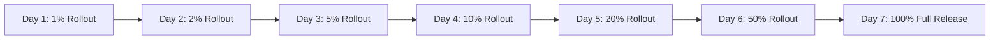

# Arthentic Mobile: TestFlight Beta, Release & Staged Rollout Strategy

This document details the release management, TestFlight beta staging, App Store submission checklist, and operational monitoring strategy for **Milestone 7 (Release)**.

---

## 1. TestFlight Beta Rollout Plan

### 1.1 Phase 1: Internal QA Beta (Days 1–3)
* **Audience**: Core development team and security auditors (up to 25 testers).
* **Scope**:
  * Cold start routing, Face ID and device passcode fallback testing across supported iOS models (iPhone 12 through iPhone 16 Pro).
  * App lock background grace periods (Immediately, 15s, 30s, 1m, 5m).
  * Google and Apple OAuth authentication and auto-linking.
  * Accreditation application submissions with PDF document uploads.
  * Hardware NFC chip reading and LiDAR surface fingerprint verification.

### 1.2 Phase 2: Closed Verifier & Partner Beta (Days 4–10)
* **Audience**: 100 external accredited partners (Artists, Galleries, Conservators, and Collectors).
* **Focus Areas**:
  * Real-world physical artwork genesis baseline captures.
  * Role switcher experience for multi-role accounts.
  * Remote session management and device revocation from Settings.
  * Zero-PII crash reporting telemetry validation in live network conditions.

---

## 2. App Store Submission & Compliance Checklist

| Requirement | App Store Guideline | Implementation Details | Verification |
|---|---|---|---|
| **Sign in with Apple** | Guideline 4.8 | Native Apple Sign-In button implemented on Login Screen alongside Google. | [login_screen.dart](file:///Users/rkz/Documents/Project_Folder/Arthenthic-Mobile/app/lib/features/auth/login_screen.dart) |
| **Account Deletion** | Guideline 5.1.1(v) | In-app account deletion button with immediate PII wipe and session revocation. | [settings_screen.dart](file:///Users/rkz/Documents/Project_Folder/Arthenthic-Mobile/app/lib/features/settings/settings_screen.dart) |
| **Biometric Privacy** | Privacy Guideline | `NSFaceIDUsageDescription` configured in Info.plist; Face ID evaluation executes strictly in Secure Enclave. | [Info.plist](file:///Users/rkz/Documents/Project_Folder/Arthenthic-Mobile/app/ios/Runner/Info.plist) |
| **Export Compliance** | US Commerce EAR | `<key>ITSAppUsesNonExemptEncryption</key><false/>` set in Info.plist for standard HTTPS/Argon2id without proprietary ciphers. | [Info.plist](file:///Users/rkz/Documents/Project_Folder/Arthenthic-Mobile/app/ios/Runner/Info.plist) |
| **Camera & NFC** | Hardware Access | `NSCameraUsageDescription` and `NFCReaderUsageDescription` with clear user-facing descriptions. | [Info.plist](file:///Users/rkz/Documents/Project_Folder/Arthenthic-Mobile/app/ios/Runner/Info.plist) |

---

## 3. Production Staged Rollout Schedule (7-Day Phased Release)

To detect potential regressions or device-specific edge cases early, App Store phased release will be deployed over 7 days:

* **Day 1 (1%)**: Monitor backend Prometheus metrics (`/metrics`) and error logs. Verify token refresh rates.
* **Day 2 (2%)**: Monitor auth failure rates across newer iOS minor versions.
* **Day 3 (5%)**: Check remote session revocation and biometric unlock latency.
* **Day 4 (10%)**: Check gallery batch verifications and document upload traffic.
* **Day 5 (20%)**: Review audit logs and rate-limiting triggers.
* **Day 6 (50%)**: Scale backend database read replicas if necessary.
* **Day 7 (100%)**: Full availability on the App Store.

---

## 4. Monitoring KPIs & Alerting Thresholds

The server exposes Prometheus-compatible metrics on `GET /metrics` and authenticated health summaries on `GET /v1/admin/monitoring/stats`:

| Metric Name | Prometheus Identifier | Healthy SLA | Alert Threshold (P1/P0) | Action Required |
|---|---|---|---|---|
| **Login Failure Rate** | `auth_login_failures_total / total_logins` | < 1.0% | **> 2.5%** (over 5m window) | Investigate potential credential stuffing or auth endpoint outage. |
| **Token Refresh Failure Rate** | `auth_refresh_failures_total / total_refreshes` | < 0.2% | **> 0.8%** (over 5m window) | Check database connectivity, clock drift, or token corruption. |
| **Token Reuse / Theft Detection** | `auth_token_reuse_events_total` | **0** | **> 0** (Instant P0 Page) | Token family revoked automatically; investigate IP and target account in `audit_log`. |
| **Lock Bypass / Tamper Reports** | `app_lock_bypass_reports_total` | **0** | **> 0** (Instant P0 Page) | Client reported local auth bypass or abnormal biometric failure; triage device. |
| **Rate Limit Triggers** | `rate_limited_requests_total` | Baseline | **> 50 / min** | Check IP addresses for automated scraping or brute force attacks. |

---

## 5. Rollback Playbook

If any P0 alert triggers during the staged rollout:

1. **Pause App Store Phased Release**:
   In App Store Connect → *App Releases* → Select current build → Click **Pause Phased Release**.
2. **Client-Side Graceful Fallback**:
   If an edge-case crashes the app during Face ID, `AppLockGate` fails open to device passcode prompt without server dependencies.
3. **Emergency Token Key Invalidation**:
   If a security breach is detected, follow [RUNBOOK_KEY_ROTATION.md](file:///Users/rkz/Documents/Project_Folder/Arthenthic-Mobile/docs/RUNBOOK_KEY_ROTATION.md) to instantly rotate keys and revoke compromised token families.
4. **Hotfix Deployment**:
   Prepare build with incremented build number (e.g. `1.0.1+2`), run full CI test suites (`pytest server/tests/` and `flutter test`), and submit for expedited App Store review.

