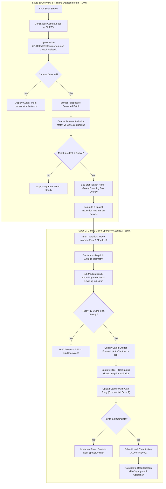

# Vision Scanning & Painting Detection: Implementation Plan & Test Design

## 1. Executive Summary & Architecture Overview

The enhanced vision scanning system transforms the scanning experience from a blind, jittery macro capture into an intelligent, two-stage computer vision pipeline:



---

## 2. Test-First Specification & Test Suite Design

Before implementing any production code changes, the verification suite must be constructed across three distinct test tiers to guarantee functionality and avoid regression.

### Tier 1: Flutter Widget & State Tests (`app/test/vision_scanning_test.dart`)

| Test Case | Scenario / Preconditions | Expected Assertion |
| :--- | :--- | :--- |
| **T1.1: Stage 1 Initial State** | Initialize `ScanScreen` with `artwork` | Stage 1 Overview HUD is active; prompt reads `"Frame the complete artwork"`; Stage 2 shutter is hidden or inactive. |
| **T1.2: Rectangle Detection Overlay** | Emit simulated 4-corner polygon `(tl, tr, br, bl)` via `CaptureChannel` | `CanvasBoundingBoxPainter` renders boundary polygon conforming to normalized coordinates; reticle tracks canvas center. |
| **T1.3: Stabilization Gate & Auto-Transition** | Emit steady rectangle + 88% visual match for 1,200ms | 1.2s countdown triggers audio/haptic feedback; UI state smoothly transitions from Stage 1 to Stage 2 (`currentStage == ScanStage.macroInspection`). |
| **T1.4: 8-Point Spatial Target Projection** | Inspect anchors after Stage 1 lock | Calculated coordinates for points 1–8 match standard normalized quad offsets (e.g. Pt 1 Top-Left at `[0.15, 0.15]`, Pt 7 Bottom-Center at `[0.50, 0.85]`). |
| **T1.5: Telemetry Smoothing & Jitter Rejection** | Feed oscillating depth signals `[11, 14, 18, 14, 14]` to telemetry sink | Smoothed output remains within optimal window `(14cm)`; avoids flickering between "Too Close" and "Too Far". |
| **T1.6: Pitch/Roll Leveling Gating** | Set camera pitch/roll tilt to 18° off-normal | Pitch warning banner is visible; shutter remains disabled; leveling reticle indicates tilt direction. |
| **T1.7: Upload Failure Auto-Retry** | Simulate 503 HTTP timeout on upload of Point 3 | System attempts 3 exponential backoff retries without stranding user or losing points 1 and 2. |
| **T1.8: Full 8-Point Scan Completion** | Complete captures 1 through 8 | Navigates to `ResultScreen` with valid Level 2 verification payload. |

---

### Tier 2: iOS Native XCTests (`app/ios/RunnerTests/CaptureChannelTests.swift`)

| Test Case | Method / Component | Verification Criteria |
| :--- | :--- | :--- |
| **T2.1: Vision Rectangle Detection Pipeline** | `VNDetectRectanglesRequest` on synthetic canvas sample | Accurately locates 4 corners with confidence >= 0.85; rejects non-quadrilateral shapes. |
| **T2.2: 5x5 Median Depth Filtering** | CVPixelBuffer depth processing with noisy salt-and-pepper pixels | Single dead/infinite pixels in depth map are rejected; filtered center depth equals local neighborhood median within 1mm. |
| **T2.3: Attitude / Orientation Estimation** | `ARFrame.camera.transform` pitch and roll extraction | Accurately returns roll/pitch angles in degrees relative to gravity vector; flags tilt > 12°. |
| **T2.4: Non-LiDAR Pro Fallback** | Device without `.sceneDepth` frame semantics | Gracefully falls back to stereo/optical focus depth estimation or calibrated baseline relief, returning `isLiDARActive: false` without throwing exceptions. |
| **T2.5: Intrinsics Serialization** | `ARCamera.intrinsics` to dictionary conversion | Encodes `fx, fy, cx, cy` faithfully with IEEE 754 precision. |

---

### Tier 3: Python Backend End-to-End Verification (`server/tests/test_surface_verification.py`)

| Test Case | Endpoint / Function | Verification Criteria |
| :--- | :--- | :--- |
| **T3.1: Coarse Overview Match Verification** | `/v1/captures/overview-match` (or embedding similarity) | Compares perspective-corrected overview photo patch against genesis baseline vector; accepts >= 0.80 cos similarity, rejects mismatch (< 0.70). |
| **T3.2: Multi-Point Spatial Grid Alignment** | `/v1/verify/level2` with 8 sequential captures | Validates spatial order `(1..8)`; computes aggregate similarity score and verifies relief roughness per point. |
| **T3.3: Missing / Out-of-Order Recovery** | `/v1/verify/level2` with missing point indices | Returns clear semantic validation error code `INVALID_POINT_SEQUENCE`. |

---

## 3. Phase-to-Phase Implementation Plan

### Phase 1: Native iOS Vision & Depth Stabilization
**Objective**: Build reliable on-device vision rectangle detection, tilt/attitude tracking, and depth buffer smoothing into the iOS native bridge.

1. **`app/ios/Runner/AppDelegate.swift`**:
   - Implement `VNDetectRectanglesRequest` in `ARSessionDelegate` (or background dispatch queue throttled to 15-30 FPS) to detect artwork frame quads.
   - Extract `ARFrame.camera.eulerAngles` (pitch, roll, yaw) for camera flatness/perpendicular leveling.
   - Replace single-pixel depth sampling with a 5x5 window median filter over `sceneDepth.depthMap` to eliminate specular noise and flicker.
   - Add new method channel endpoints:
     - `startPaintingDetection()` & `stopPaintingDetection()`
     - Update `getLiveTelemetry()` to return `detectedRectangle` (4 normalized corners), `tiltDegrees`, `distanceCm`, and `isLeveled`.
2. **`app/lib/capture/capture_channel.dart`**:
   - Expose Dart bindings for `startPaintingDetection()`, `stopPaintingDetection()`, and the enriched telemetry model (`DetectedPaintingQuad`, `CameraAttitude`).
   - Implement simulated mock rectangle detection and smooth telemetry for macOS/Web/Android development.

---

### Phase 2: Stage 1 UI & Guided Bounding Box Overlay
**Objective**: Create the Overview & Painting Detection user experience in Flutter.

1. **`app/lib/features/scan/scan_screen.dart`**:
   - Introduce `ScanStage` enum: `overviewDetection` and `macroInspection`.
   - In `overviewDetection`:
     - Render custom painter `PaintingBoundingBoxPainter` drawing animated corner brackets around detected painting corners with real-time perspective distortion.
     - Add visual status pill: "Detecting Artwork... Hold steady at ~0.8m".
     - Once detected with >= 80% match, trigger the 1.2-second stabilization ring animation.
     - Display mapped positions of all 8 target points on the detected canvas frame.
     - On completion of the 1.2s timer, trigger haptic feedback (`HapticFeedback.heavyImpact()`), play a smooth zoom animation, and transition to Stage 2.

---

### Phase 3: Stage 2 Macro Surface Scan Overhaul
**Objective**: Overhaul close-up scanning with pitch leveling, intuitive target reticles, and robust gating.

1. **Leveling & Distance HUD**:
   - Add a crosshair leveling indicator (artificial horizon / bullseye) that glows green when camera tilt is within ±5° of normal to canvas.
   - Distance gauge with smooth color transition (Amber = 8-11cm, Green = 12-16cm, Amber = 17-22cm).
2. **Spatial Target Reticle**:
   - Show dynamic mini-target positioning on the canvas that highlights the current point (1 through 8) with contextual guidance (e.g., "Aim at Top-Left Corner").
3. **Capture Upload Resilience**:
   - Implement exponential backoff retry in `apiClient.uploadCapture` (3 retries with jitter).
   - Show capture progress in segmented bar with upload confirmation checkmarks.

---

### Phase 4: Non-LiDAR & Fallback Calibration
**Objective**: Ensure graceful degradation on devices lacking hardware LiDAR scanners (e.g. standard iPhones, Android, web prototypes).

1. In `CaptureChannel`:
   - Calibrate optical focal distance estimation using camera intrinsics when `.sceneDepth` is absent.
   - Fall back to synthetic relief roughness modeling (`0.45mm` nominal) with flagged `lidarPresent: false` metadata.
2. In `server/routes/verify.py` & `server/ml/depth_features.py`:
   - Handle verified optical texture consistency even when hardware depth map is simulated or lower resolution.

---

### Phase 5: Verification & End-to-End Polish
**Objective**: Execute full test suites, measure frame rates, verify memory safety, and validate user workflows.

1. Run Flutter unit & widget test suite (`flutter test test/vision_scanning_test.dart`).
2. Run backend test suite (`pytest server/tests/test_surface_verification.py`).
3. Verify on device:
   - Stage 1 locks painting within 500ms of entering frame.
   - Stage 2 completes all 8 points in under 45 seconds.
   - Verification attestation produced and stored in DB and provenance ledger.

---

## 4. Key Architectural Deliverables & File Changes

```
app/
├── ios/Runner/AppDelegate.swift           # Native VNDetectRectanglesRequest, 5x5 depth filter, attitude angles
├── lib/
│   ├── capture/capture_channel.dart       # Extended API, DetectedQuad, smoothed mock telemetry
│   ├── features/scan/
│   │   ├── scan_screen.dart               # Two-stage coordinator, state machine, transitions
│   │   ├── widgets/
│   │   │   ├── painting_bounding_box.dart # Stage 1 perspective quad painter & anchor dots
│   │   │   ├── leveling_indicator.dart    # Pitch/roll artificial horizon crosshair
│   │   │   └── distance_gauge.dart        # Responsive distance bar with smooth damping
│   └── services/api_client.dart           # Auto-retry upload with exponential backoff
└── test/
    └── vision_scanning_test.dart          # Comprehensive 8-test suite for Stage 1 & Stage 2
server/
└── tests/
    └── test_surface_verification.py       # Multi-point spatial and overview matching tests
```

